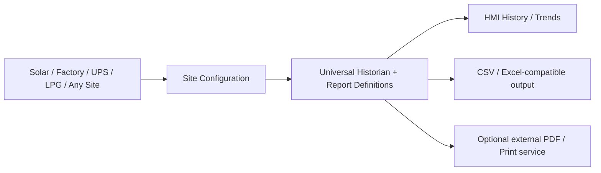

# Universal Industrial Historian & Reporting — Weintek

**Ek engine, multiple sites.** Configurable historical reports for solar / grid / DG, industry, UPS, LPG, HVAC and utilities. **Currently in design/R&D**; no production or hardware acceptance claim.

## Owner quick navigation
| See this | Link |
|---|---|
| **One-page status (Roman Urdu)** | [Owner Dashboard](docs/OWNER_DASHBOARD.md) |
| **Pictorial roadmap / architecture** | [Visual Plan — GitHub-rendered diagrams](docs/VISUAL_PLAN.md) |
| **Which historical reports?** | [22 planned report templates](docs/REPORT_CATALOG.md) |
| **All R&D sources and vendor web links** | [Research Library](research/INDEX.md) |
| **Authoritative issue/task tracking** | [Command Centre #1](https://github.com/raohassandev/Weintek-Macro-Javascript-based-reporting/issues/1) |

## System at a glance

**Site dependent:** actual devices/register maps, metric types, timezone, sample and retention settings, report selection, output.  
**Reusable:** data semantics, period filters, calculation rules, quality/gap handling, report templates and test contracts.

## Technical source of truth
- [Site profile schema](schemas/site-profile.schema.json), [configuration guide](docs/SITE_PROFILE_GUIDE.md) and [fictional sample sites](examples/site-profiles)
- [Architecture](docs/ARCHITECTURE.md) · [Master Plan](docs/MASTER_PLAN.md) · [Requirements/Acceptance](docs/REQUIREMENTS_AND_ACCEPTANCE.md)
- [Project/chat context](docs/PROJECT_CONTEXT.md) · [Decision Log](docs/DECISION_LOG.md) · [Activity Log](docs/ACTIVITY_LOG.md)
- [Weintek feature matrix](docs/MODEL_COMPATIBILITY.md) · [POC test plan](docs/POC_TEST_PLAN.md) · [Official reference links](docs/REFERENCE_LINKS.md)
- [R&D evidence register](research/SOURCE_REGISTER.json) · [Open questions](research/OPEN_QUESTIONS.md) · [Real experiment log](research/EXPERIMENT_LOG.md)
- [Worker protocol](docs/WORKER_PROTOCOL.md) · [AI/contributor rules](AGENTS.md)

## Safety/feature honesty
Weintek manufacturer release notes confirm SQL Query can access SQLite on USB/SD for supported cMT devices. The exact combination **SQL Query Advanced Mode + Local SQLite** remains unverified; older manuals describe Advanced custom SQL mainly with MySQL/MS SQL. Do not assume unrestricted SQLite APIs in Macro/JavaScript or unrestricted access to HMI native log files. A formatted multipage PDF is a separately verified export capability, typically via external reporting service. Never treat `SUM(kW)` as energy kWh.

No real customer data, credentials, fabricated test results, or copied proprietary manuals in this public repository.

**As of:** 2026-10-13.
