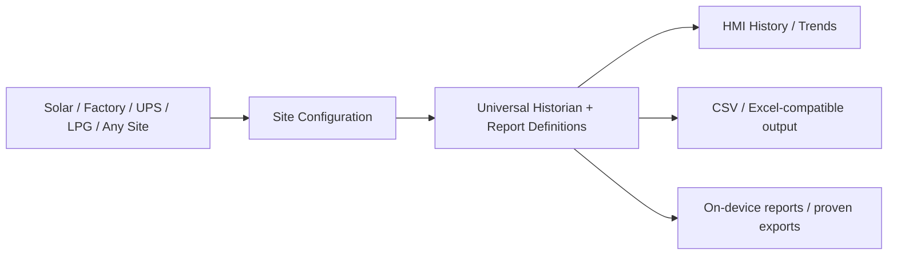

# UCS — Universal Control & Supervisory System (Weintek-only)

**Ek engine, multiple sites.** Configurable historical reports for solar / grid / DG, industry, UPS, LPG, HVAC and utilities. **Currently in design/R&D**; no production or hardware acceptance claim.

## Primary screen decision — authentic plant SLD, NOT synthetic dashboards
**Owner rejected prior generated 110/120/130 generic role-home designs.** Main UCS display must be the **actual site electrical single-line diagram (SLD)** on cMT-FHDX-220, using EBPro native objects and supported JS Object Canvas. The electrical graph/coordinates are site-dependent configuration; no web app or extra runtime PC/IPC. **No actual plant SLD drawing/meter feeder map exists in this repo yet**, so visually accurate drawing is BLOCKED rather than invented. [Authoritative SLD design contract](docs/PLANT_SLD_PRIMARY_SCREEN_CONTRACT.md) · [Issue #43](https://github.com/raohassandev/Weintek-Macro-Javascript-based-reporting/issues/43). Earlier 1080p screens are archived/rejected concept art only. GATE-1 DOC PASS preceded this design change, so this UI delta needs a new design audit.

## GATE-1 design audit outcome and offline screen assets
**Independent PLAN audit PASS (owner-transmitted)** for frozen SHA `a22eeeebe1e4ded14219b497de30f5ffd9cedf90` at DOC/OFFLINE level only; [result](docs/GATE1_INDEPENDENT_PLAN_AUDIT_RESULT.md). **Q01/Q02/Q10/Q04-Q12 BLOCKED; implementation #28/#29 HOLD pending actual System Info/EBPro and owner authorization.**
Four deterministic **1920×1080** preview/background source packs: [Operator](designs/screens/110-operator-home/), [Engineer](designs/screens/120-engineer-home/), [Management](designs/screens/130-management-home/), [Resource](designs/screens/510-resource-manager/). [Ready-to-build DOC-only 2-meter handoff](planning/2-meter-fhdx220/README.md). [Asset generator](tools/build_ucs_screen_packs.py) can rebuild images without a PC in the *deployed runtime*.

## Active HMI target
**Weintek cMT-FHDX-220 (owner-selected).** [Hardware plan](docs/HARDWARE_TARGET_FHDX_220.md), [test contract](contracts/hardware-target.json). One USB2 host, **no SD/microSD**, 1920×1080 HDMI; native EBPro JS Object and SQL Query listed, PLC Web Browser **820-only**. Actual OS/EBPro and performance pending. No PC/IPC runtime.

## DESIGN FINALIZATION BEFORE INDEPENDENT AUDIT (owner workflow)
**Do not start EBPro implementation yet.** Finish/merge [planning freeze #37](https://github.com/raohassandev/Weintek-Macro-Javascript-based-reporting/issues/37), obtain real independent [plan audit #38](https://github.com/raohassandev/Weintek-Macro-Javascript-based-reporting/issues/38), resolve findings and wait for owner authorization. [Frozen plan/audit gate](docs/PLAN_FREEZE_PRE_IMPLEMENTATION_AUDIT.md) · [FHDX-220 1080p screen design](docs/SCREEN_DESIGN_BRIEF_FHDX220.md) · [Single-USB backup safety](docs/FHDX220_SINGLE_USB_STORAGE_RISK.md) · [Dynamic screen](docs/DYNAMIC_SCREEN_ARCHITECTURE.md) · [Memory contract](docs/WEINTEK_MEMORY_CONTRACT.md). [External plan findings AF-01..08](docs/PLAN_AUDIT.md) are included here with their offline golden energy fixtures. The older green [PR #35](https://github.com/raohassandev/Weintek-Macro-Javascript-based-reporting/pull/35) audit findings/offline fixtures are being incorporated into the freeze without overwriting the FHDX-220 decision.

## FINAL BASELINE v1.0 — primary entrypoint
**Read these first (authoritative, 2026-10-13):**
1. **[UCS FINAL ENGINEERING MASTER PLAN](docs/UCS_FINAL_MASTER_PLAN.md)** — full customer context, architecture, registers, 61-meter historian, UX, reporting, hardware limits, milestones and constraints.
2. **[AI IMPLEMENTATION HANDOFF](docs/AI_AGENT_EXECUTION_BRIEF.md)** — exactly how another AI/engineer resumes and works safely.
3. **[INDEPENDENT AI AUDIT PROTOCOL](docs/INDEPENDENT_AUDIT_PROTOCOL.md)** — evidence gates, findings, security and release criteria.
4. **[36 REQUIREMENTS & EVIDENCE MATRIX](docs/UCS_REQUIREMENTS_TRACEABILITY.md)** — verification not vague percentages.
5. **[PARALLEL EXECUTION WORKPACKAGES](docs/UCS_DELIVERY_WORKPACKAGES.md)** — scoped engineering ownership, dependencies, accepted outputs.
6. **[LIVE COMMAND CENTRE #1](https://github.com/raohassandev/Weintek-Macro-Javascript-based-reporting/issues/1)** — statuses and precise blockers.

Baseline **finalizes plan/scope**, not physical HMI functionality or customer acceptance. Weintek only; no PC/IPC/server runtime.

## Owner quick navigation
| See this | Link |
|---|---|
| **One-page status (Roman Urdu)** | [Owner Dashboard](docs/OWNER_DASHBOARD.md) |
| **Pictorial roadmap / architecture** | [Visual Plan — GitHub-rendered diagrams](docs/VISUAL_PLAN.md) |
| **Resource & Storage Manager screen** | [Executive theme: SVG screen + engineer source pack](designs/resource-manager/README.md) |
| **USB vs Industrial SSD** | [Storage decision & capacity](docs/STORAGE_DECISION_AND_CAPACITY.md) |
| **Which historical reports?** | [22 planned report templates](docs/REPORT_CATALOG.md) |
| **All R&D sources and vendor web links** | [Research Library](research/INDEX.md) |
| **Authoritative issue/task tracking** | [Command Centre #1](https://github.com/raohassandev/Weintek-Macro-Javascript-based-reporting/issues/1) |

## Approved scope (2026-10-13)
**All processing and history are Weintek-only**: selected cMT-FHDX-220, single USB2 or qualified USB-SSD, **NO SD/microSD**, no external computer runtime. [Revised architecture](docs/VISUAL_PLAN.md) · [Role-specific home screens](docs/ROLE_BASED_UX_PLAN.md) · [Web HTML feasibility](research/WEINTEK_HTML_FEASIBILITY.md) · [Official demo project review](research/DEMO_PROJECTS_REVIEW.md).

## System at a glance

**Site dependent:** actual devices/register maps, metric types, timezone, sample and retention settings, report selection, output.  
**Reusable:** data semantics, period filters, calculation rules, quality/gap handling, report templates and test contracts.

## Technical source of truth
- [Site profile schema](schemas/site-profile.schema.json), [configuration guide](docs/SITE_PROFILE_GUIDE.md) and [fictional sample sites](examples/site-profiles)
- [Architecture](docs/ARCHITECTURE.md) · [Master Plan](docs/MASTER_PLAN.md) · [Requirements/Acceptance](docs/REQUIREMENTS_AND_ACCEPTANCE.md)
- [Project/chat context](docs/PROJECT_CONTEXT.md) · [Decision Log](docs/DECISION_LOG.md) · [Activity Log](docs/ACTIVITY_LOG.md)
- [Weintek feature matrix](docs/MODEL_COMPATIBILITY.md) · [POC test plan](docs/POC_TEST_PLAN.md) · [Official reference links](docs/REFERENCE_LINKS.md)
- [R&D evidence register](research/SOURCE_REGISTER.json) · [Open questions](research/OPEN_QUESTIONS.md) · [Real experiment log](research/EXPERIMENT_LOG.md)
- [Worker protocol](docs/WORKER_PROTOCOL.md) · [AI/contributor rules](AGENTS.md)

## Safety/feature honesty
Weintek manufacturer release notes confirm SQL Query can access SQLite on USB/SD for supported cMT devices. The exact combination **SQL Query Advanced Mode + Local SQLite** remains unverified; older manuals describe Advanced custom SQL mainly with MySQL/MS SQL. Do not assume unrestricted SQLite APIs in Macro/JavaScript or unrestricted access to HMI native log files. A formatted multipage PDF remains UNPROVEN as an on-device Weintek generation feature; no external PC/IPC is permitted. Never treat `SUM(kW)` as energy kWh.

No real customer data, credentials, fabricated test results, or copied proprietary manuals in this public repository.

**As of:** 2026-10-13.
