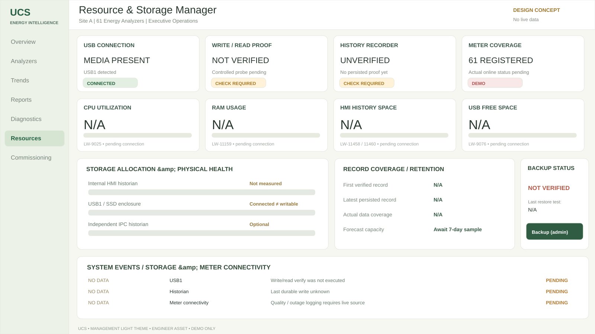

# UCS Resource Manager — Light Executive Theme / Engineer Package



**Status:** source SVGs, tag dictionary, actual EBPro native-object mapping, Local HMI JS storage probe and Macro source are prepared in repository. No .cmtp/.emtp project and no physical SVRX/FHDX result has been generated yet.

## Source assets
- [Management preview SVG](resource-manager-light.svg): 1600×900 executive theme; example/placeholder values are not live.
- [Background-only SVG](resource-manager-background-only.svg): **THIS** asset is intended for converting to PNG and importing as EBPro Picture object. Dynamic values are intentionally absent to avoid duplication.
- [Objects map](screen-object-map.csv) — choose supported native EBPro objects for every real value, lamp, bar, backup and event panel.
- [Tag dictionary](../../tags/resource-manager-dictionary.csv), [safe CSV import instructions](../../tags/EBPRO_IMPORT_GUIDE.md).
- [Read/write probe JS Action](../../js/ucs_usb_write_read_probe.js), [health Macro](../../macros/UCS_STORAGE_STATUS.mcr).
- [Screen technical specification](../../docs/RESOURCE_STORAGE_MANAGER_SCREEN.md).

## Generate EBPro-ready PNG from assets
```bash
python -m pip install cairosvg
python tools/render_hmi_assets.py
```
Outputs `designs/resource-manager/resource-manager-background-only.png` **without** baked-in live numbers and preview PNG. PNG should be a Picture/background, with live EBPro Numeric/Bar Graph/Word Lamp/Event Display objects layered above. Do NOT put SVG directly into EBPro unless the target build explicitly supports it.

## Connection versus working
`USB connected` reads `LB-12048` but does not prove FAT32 is writable. `Write/read verified` requires a recent successful isolated USB file I/O test with correct byte readback (EBPro >=6.09.01 and **Local HMI JS**, model-dependent). `Recording verified` requires an independent actual persisted-record heartbeat. Latched old PASS states are invalid after media reconnect and after proof TTL. Backup verification requires a file and data validation step. Stale or unsupported metrics show N/A.

## Exact engineering steps
1. In EBPro `Project → Address`, verify supported built-in `System Tags`, create a few manually and export CSV. The included generic dictionary is **not** an already native-importable EBPro file.
2. Create a single window (proposal window #510), import PNG background as Picture, add native objects per [map](screen-object-map.csv). Avoid writing system register control bits accidentally.
3. Configure safe register addresses `LW-8250..8253` and `LW-8270`, track aging in a separate trusted watchdog. `LW-8251`/8253 default to stale (>120s), not zero. Independently configured Log/Backup objects remain active on all pages.
4. Add **engineer/admin-only, on-demand** JS probe action and show probe age and failures; do not run file writes per screen repaint.
5. Validate 2-meter simulator, then real SVRX/FHDX media/OS (USB absent, read-only, full, unplugged, remount, recording stalled), then 61 meters.
6. Record actual EBPro exported tag template/version and device logs on [issue #19](https://github.com/raohassandev/Weintek-Macro-Javascript-based-reporting/issues/19).

## References
- [WeintekUSA Objects FAQ](https://www.weintekusa.com/faq/) (Bar Graph, Lamp, Meter Display, Picture, JS Object)
- [EBPro System Registers](https://dl.weintek.com/public/EBPro/UserManual/eng/UserManual_separate_chapter/Chapter-22-System-Registers-UserManual-eng.pdf)
- [Official JS stdio file read/write](https://dl.weintek.com/public/Document/JS_Object_SDK/Current/module-%40weintek_libc_stdio.html)
- [Official Address Tag Library CSV](https://dl.weintek.com/public/EBPro/UserManual/eng/UserManual_separate_chapter/Chapter-16-Address-Tag-Library-UserManual-eng.pdf)
- [2026 internal eMMC write rate](https://www.weintek.com/About/NewsDetail/TechNews-Vol.79)
