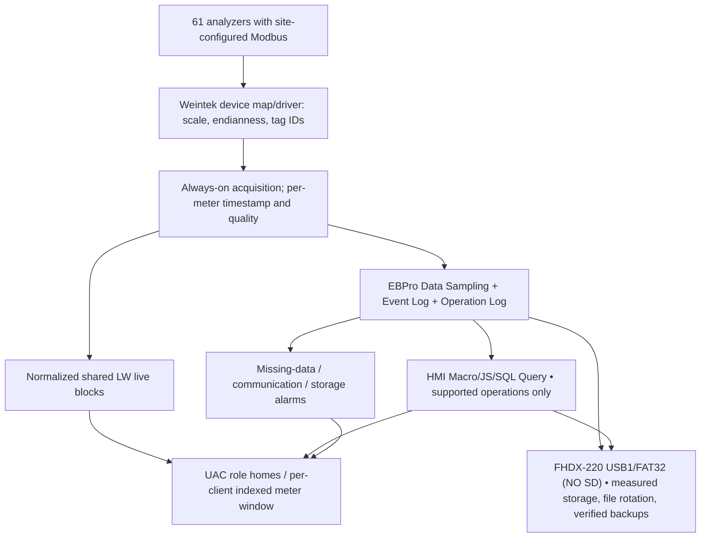

# UCS runtime architecture — **Weintek-only** (approved 2026-10-13)
[Live visual](VISUAL_PLAN.md) · [Role UI](ROLE_BASED_UX_PLAN.md) · [History integrity](STORAGE_DECISION_AND_CAPACITY.md) · [HTML R&D](../research/WEINTEK_HTML_FEASIBILITY.md)

## Hard boundary
The owner-selected **cMT-FHDX-220** operates real-time collection, visualization, historian, alarms, and on-device report logic. The owner's explicit exclusion of third-party PC/IPC/server also excludes using such a device as the PDF generator or query processor. Other **Weintek hardware**, if required, must be separately approved; a standalone HTML browser variant does not automatically add historian logic.

## Data path

## Acquisition, status and historian invariants
- One device ID (1–61) maps to one versioned driver profile and normalized quality/time fields. Hardware maps differ by model; avoid 61 copies of per-device pages.
- Regardless of which screen is selected, sampling for every commissioned analyzer proceeds. Native Weintek sampling capacity, simultaneous history objects, tags, and on-screen refresh must be benchmarked on exact SVRX/FHDX hardware.
- Missing / bad value is NULL or gap/state marker in report semantics, **not measured zero**. Independent `last_attempt`, `last_good`, `last_persisted` and origin flags provide audit/trace. Persist event intervals when communication or storage fails; reboot/power-loss recovery cannot retroactively recover data the meter never supplied.
- Use `LW` shared volatile normalized blocks only as live cache. UAC and per-session `PLW` state keeps one shared detail screen independent for cMT Viewer clients. No global selected meter shared across sessions.
- Native Trend Display binding and Local SQLite query capabilities need proof. Do not claim arbitrary SQL, generic SQLite file API, or WebView acting as a custom file server.
- Config can adjust site labels, tag mapping, supported driver parameters via approved HMI configuration/recipe settings. New drivers/extra project hardware objects may **still** require EBPro download; do not claim fully unlimited runtime commissioning.

## Report tiers WITHIN Weintek (no external computer)
1. **Native**: History Data Display, Trend Display, Event Log, Data Sampling, official Backup/CSV and PDF Reader if available (reader is not a PDF creator).
2. **On-device enhanced**: site-defined Macro & JS Object/JS Action, SQL Query object to approved backend/storage path where supported, tested custom report rows/paging, on-HMI screens and documented export behavior.
3. **Needs device R&D**: arbitrary SQL on local historian, PDF generation with brand/pagination, random HTML hosting from USB, and 61×period data performance. Mark BLOCKED or UNSUPPORTED until proven, **never silently fall back to PC/IPC**.

## Storage (single Weintek)
- Prefer qualified FAT32 USB1; FHDX-220 has NO SD slot, and just one USB host with controlled bounded file retention. USB-attached SSD is a *test candidate*, not a guaranteed officially supported filesystem/enclosure. Avoid claiming SATA/NVMe slot.
- Independently monitor media presence, write/read proof, persisted-record activity, free space, last verified backup, and age/quality.
- A second removable device used for manual/offline recovery does **not** execute software; no extra computer runtime.
- Data growth rate / 61-analyzer capacity forecast based on actual write benchmark (inc. file rotation and free-space reserve); failure state must be captured, visible in diagnostic report and escalated appropriately.

## Rendering & HTML distinctions
- JS Object in EBPro provides Canvas drawing and event handling, **not browser DOM or HTML CSS execution**. Use one reusable JS object/window with shared input register/role state.
- PLC Web Browser shows external URL-based web pages **on local screen of supported HMI**, notably FHDX-820 in feature table; not a general-purpose HTML engine. The FHDX-220 is **not supported** for PLC Web Browser in Appendix A (820 only).
- EasyWeb/WebView remotely render/control HMI projects, **not an arbitrary HTML document hosting feature**.
- The separately sold cMT-FHDX-820 **(W)** is HTML5 Web Panel/Chromium display; its presence is **not proof that it can run EasyBuilder acquisition/historian**. It normally needs a URL/page source. No external web server is authorized. Local USB `file://` path and dynamic Modbus integration are open tests, not commitments.

## Security
UAC role permissions at navigation, data sources AND action destination. cMT Viewer runs some JS actions on client device (vendor support 2026-01-20): never rely on client-only JS to guard report rights / Modbus writes / dangerous backups. Action Trigger (Global) once/local macro path for backend with scoped guards. Implement notification rate limiting, acknowledgement and escalation; critical events must not vanish after popup.
