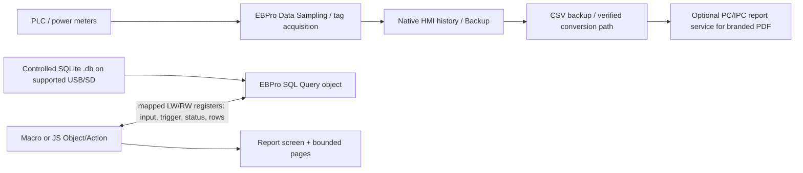
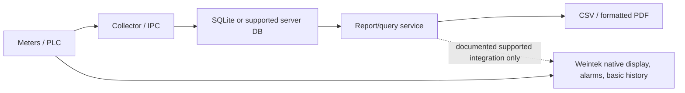

# Technical architecture — constrained interfaces
**State:** proposed architecture, not commissioned.

## Architecture A — supported Advanced cMT HMI + controlled local SQLite

**Important:** a connection from native HMI history to the controlled SQLite source is deliberately **not drawn**. It is a research/test item, not a settled capability. SQLITE `SELECT` statement semantics and Advanced Mode availability for the chosen local SQLite version must be bench-tested.

## Architecture B — external historian/reporting fallback
If the selected HMI lacks SQL Query/local SQLite or requirements exceed it:

Select implementation after total cost, reliability, power-cycle recovery and customer security constraints are known.

## Integration boundary
- Weintek **Macro**: documented HMI operations and configured query registers; `RecipeQuery` handles recipes, not arbitrary SQLite.
- Weintek **JavaScript SDK**: use only functions verified in SDK revision, e.g. data exchange with local device registers. Do **not** assume `sqlite.open`, `sqlite3`, Node filesystem, network modules or arbitrary SQL execution APIs.
- SQL Query: configure database backend and predetermined commands in EBPro; bridge query IDs / parameters / status / errors through actual documented mappings.
- Query design: bounded time range, `LIMIT`/page, indexed timestamp, deterministic sort, `COUNT`, daily totals, max, min/avg with data-quality handling.
- Native historian: acquisition and backups are their own subsystem. Verify file formats and schema before cross-querying.

## Data contract (proposed, not Weintek internal schema)
```sql
CREATE TABLE readings (
    site_id TEXT NOT NULL,
    device_id TEXT NOT NULL,
    tag_id TEXT NOT NULL,
    ts_utc TEXT NOT NULL,
    value REAL,
    quality TEXT NOT NULL,
    PRIMARY KEY (site_id, device_id, tag_id, ts_utc)
);
CREATE INDEX idx_readings_time ON readings(ts_utc);
```
This is for test fixtures or external managed DB; not a claim about Weintek logger tables. Add source resolution/counter reset metadata before production energy reporting.

## Reliability, safety and operations
- No SQL string concatenation from untrusted operator input; validate date/time, device ID, page and report type before HMI register writes.
- Use read-only report queries; any writing/migration is separate admin operation.
- Handle missing/full USB, write endurance, corruption, interrupted transfers, time-zone conversion and rollovers.
- Set request timeout and busy state; no overlapping query triggers; show explicit stale/error states and last successful timestamp.
- Do not log credentials; role-restrict exported data; document offline / remote exposure.
