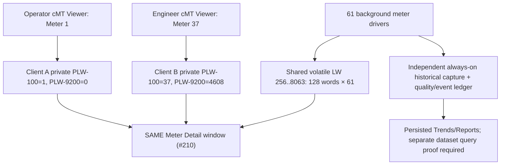

# UCS Reusable Meter Screens — FHDX-220 Architecture Design Contract
**Status:** PROPOSED; actual EBPro/cMT Viewer private indexing needs on-device test. [Screen brief](SCREEN_DESIGN_BRIEF_FHDX220.md) · [memory map](../contracts/meter-memory-map.json) · [hardware](HARDWARE_TARGET_FHDX_220.md).

## Required behavior
Exactly **ONE** shared Meter Detail window for all 61 analyzers with per-client selection. Independently captured meter blocks are read-only live snapshots; choosing meter 61 may not modify global acquisition, logging or another Viewer client's chosen meter. Driver mapping varies by brand/site in a separate versioned profile.



### Meter navigation contract
```text
on MeterTileClick(meterId):
  validate 1 <= meterId <= site_meter_count <= 61 AND user authorized
  client_plw_selected_meter = meterId
  client_private_index_0 = (meterId - 1)*128
  mark view LOADING
  open detail window #210 only after supported client-state update completed
  display normalized data only if snapshot meterId matches request and timestamp quality is fresh
```
Do not implement a Macro+Action Trigger sequence assuming an asynchronous Macro always completes before a following Window Change. Validate native Function Key/Set Word/Index Private operation in actual EBPro; otherwise handshake on client-private state before showing values. `PLW-9200` is a documented **system Private Index 0**, not free user LW storage. `LW-9200` is **global** Index 0, NOT safe for distinct Viewer clients. Exact client-private runtime on **FHDX-220 firmware** is to be verified.

### Normalized cache
See [JSON](../contracts/meter-memory-map.json): Meter 1 `LW-256..383`; Meter 2 `LW-384..511`; Meter 37 begins `LW-4864`; Meter 61 `LW-7936..8063`. Total active power is field offset 8: first `LW-264`, second `LW-392`, meter 37 `LW-4872`, last `LW-7944`. Floats use two words; cumulative energy values reserve four words. Endian/scaling must be normalized by the driver adapter, not altered in static screen copy.

### Quality and anti-cross-talk
- Every snapshot carries status, quality flags, sample timestamp, last-good timestamp, sequence number and error/reason codes. A failed sample is **not zero**. Unsupported THD/neutral/sensor info is **N/A**.
- On rapid Prev/Next, only the most recent request ID may populate the client display. If a long query result returns after meter switch, drop it; do not show Meter 1 history under Meter 37 label.
- Verify two Viewer sessions independently select meters 1 and 37, then switch while both logging in background. Check rendered title, kW, timestamp, alarms and trends.
- A client-private live index **does not necessarily dynamically retarget a native Trend Display Data Sampling object**. Use proven per-meter native history objects or bounded on-HMI report query. Mark historical selection **BLOCKED** until tested on 220.
- FHDX-220 supports external HDMI presentation; cMT Viewer concurrent behavior depends on exact OS/licensing/mode. No “infinite clients” claim.
- No runtime PC/IPC/SQL service. JS Object Canvas is not an HTML page/DOM. All sensitive writes are protected at real HMI/UAC backend, not client JS visibility.

### Acceptance before implementation can be called working
1. Vendor manual/source and exact HMI OS/EBPro for Private Index 0.
2. Physical/simulator source and compiled single EBPro window, no duplicated screens.
3. Two simultaneous Viewer sessions with independent selection and no wrong-asset data.
4. Separate Data Sampling proves both meters continued to log while only one is viewed.
5. Valid/invalid, stale/offline, counter precision and optional capability cases.
6. Screenshot/test evidence linked to [#15](https://github.com/raohassandev/Weintek-Macro-Javascript-based-reporting/issues/15), [#16](https://github.com/raohassandev/Weintek-Macro-Javascript-based-reporting/issues/16) and [#28](https://github.com/raohassandev/Weintek-Macro-Javascript-based-reporting/issues/28). **No tests have been executed on 220 yet.**
