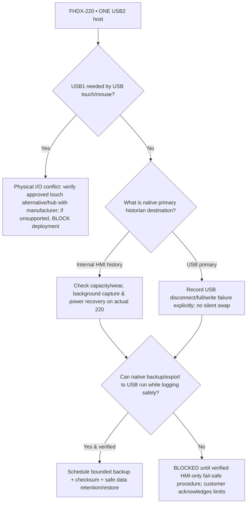

# UCS FHDX-220 — Single-USB Historian/Backup Safety Design (decision pending physical feasibility)
**Status:** approved design constraint, feasibility options NOT DEVICE-PASS. **One USB2 host**, **NO SD card**, internal 4 GB Flash not the same as 4 GB usable historian capacity.
**Scope:** No external computing hardware. Backup media is permitted only as passive removable storage; no extra PC/IPC/storage processor. [Manufacturer hardware sheet](HARDWARE_TARGET_FHDX_220.md), [master plan](UCS_FINAL_MASTER_PLAN.md).

## Why this is P0
On the chosen cMT-FHDX-220, using USB1 as a live historian destination and unplugging it for backup can interrupt logging, even if all 61 Modbus meters remain online. A USB SSD is not an independent backup of itself. A USB-connected touchscreen may already consume the only physical USB host. Native internal Flash could provide an interim buffer **only after demonstrated capacity/endurance/replay semantics**; do not design imaginary crash-safe cache. FAT32 maximum single-file limit (~4 GiB) requires rotation and compatible file format.

## Candidate topologies (do not prematurely approve one)
| Candidate | HMI historian strategy | Backup/rotation approach | Mandatory evidence and unresolved concern | Disposition |
|---|---|---|---|---|
| **A Internal native history → periodic USB archive** | All 61 channels persist inside HMI dedicated native history space | USB plugged to export/verify snapshot, removed only AFTER confirmation and without affecting data logging | Real 4 GB Flash vs available history quota, write endurance, log channels and maximum retention, file source/CSV export; USB touchscreen interference | **PREFERRED TO BENCH FIRST**, not approved |
| **B USB1 primary live history** | Local USB/FAT32 or qualified USB-SSD continuously mounted | Second removable USB medium swapped **only** under supervised maintenance when native buffering is proven to cover downtime | Prove buffer size/replay integrity, USB removal alert, no silent gaps, no simultaneous USB backup with one port; SSD bridge compatibility/power | **HIGH RISK / NOT APPROVED** until measured |
| **C One USB2 port via powered USB hub** | Historian drive + touch/backup through hub | Separate removable media if device/OS hub support verified | Vendor-approved hub, current/power budgets, filesystem identity, adapter recovery, simultaneous load with HMI UI | **UNSUPPORTED UNTIL MANUFACTURER + DEVICE-PASS** |
| **D Write twice to two locations** | Native internal log plus verified removable mirror | Snapshot integrity verified by actual native object and restore | Is simultaneous output actually offered by EBPro? No assumption that two log paths remain transactionally consistent | **R&D ONLY** |

## Recording state and incident semantics
The **USB presence register is only detection**, not functional proof. App shows five separate age-qualified signals:
1. `media_present` — USB physically enumerated (supported system tag).
2. `capacity_valid` — free amount/free-warning valid for **current** media.
3. `write_read_verified` — recent uniquely-scoped file write, reopen, byte compare test (model JS SDK support pending).
4. `historian_persisted_recently` — actual newest stored record advances (not just buffer LW changes).
5. `last_verified_backup` — independent destination and checksum/recoverability recorded.

Record events `USB_REMOVED`, `USB_NOT_WRITABLE`, `HISTORY_PAUSED`, `METER_TIMEOUT`, `HMI_POWER_OUTAGE_UNKNOWN`, `STORAGE_FULL`, `BACKUP_FAILED`, `RECOVERED`, each with exact timestamps and scope. Never attribute a logger-wide outage to all 61 meters as faulty. After restoring media, identify lost/recovered intervals; whether historic data can be recovered depends on actual meter internal history.

## Sizing method (no imaginary retention promises)
1. Confirm sampling policy for 61 meter sources: metric count per meter, sample interval, data type, historian overhead and event rate from real customer requirements.
2. Measure **actual** persisted growth over chosen period (prefer 3–7 days) with native file retention/rotation, HMI Flash/USB total/free and write performance.
3. Forecast = `floor((reliably writable free bytes minus reserve and rotation needs) / actual bytes per day)` when growth known, not when samples are insufficient. Show **N/A** otherwise.
4. Bench full USB2 throughput, 61-device poll cycle/timeout, RAM/CPU and UAC Viewer concurrency; numeric limits agreed only after measurements.
5. Qualify FAT32 USB stick and/or powered USB SSD enclosure under power loss, disconnect, remount, full-space and file-rotation tests.
6. Prove **a real native backup file**, checksum/readback and re-import/recovery. If no separate media can be attached while recording, a non-interrupting backup is **NOT PROVEN**.

## Resource Manager UX
**NO SD CARD** card, status or backup option. Show USB1 connected, usable/writable, recorder heartbeat, internal history quota (actual), estimated free-space runway (actual), last verified backup, USB touch peripheral conflict, and latest high-severity incident. Routine capacity is in Resource Manager; critical recording failure reaches Engineer Home and management report-integrity banner via Alarm Centre.

## Pre-implementation decision gate
**Plan includes candidate A first**, but cannot claim adequate 61-meter long retention or hot USB swaps. Do not begin customer site rollout or market PDF/SSD reliability until native FHDX-220 bench proves viable. If none works, report a P0 feasibility blocker and ask owner to authorize a **Weintek-only** alternative HMI or officially change retention/output policy; never silently add a PC/IPC server.

**Storage plan audit question:** Does this design actually provide continuous logging plus recoverable independent backup with one USB port and current touch input? If only a hypothetical route exists, mark this as **OPEN FEASIBILITY** rather than completed storage engineering.
