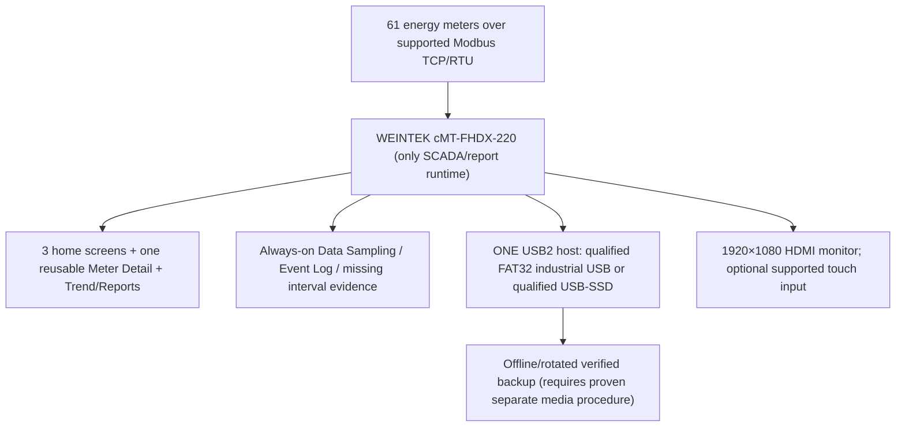

# UCS — PRIMARY HMI HARDWARE TARGET: cMT-FHDX-220
**Selection:** Owner declared `FHDX 220` as the device for current development, 2026-10-13. Normalize model name to manufacturer `cMT-FHDX-220`.
**Evidence state:** MODEL SELECTED and product family FEATURE-DOCUMENTED; **NO ACTUAL PHYSICAL DEVICE OS/FIRMWARE VERSION, EBPro compilation, site test or SQL/USB proof**. Do not confuse model selection with verified possession/working system.
**Authoritative:** [UCS master plan](UCS_FINAL_MASTER_PLAN.md) and [Command Centre #1](https://github.com/raohassandev/Weintek-Macro-Javascript-based-reporting/issues/1). Prior cMT-FHDX-820 / SVRX suggestions are **not** active build targets unless owner later approves a change.

## Physical model facts — Weintek datasheet 2021-10-21
| Property | Documented cMT-FHDX-220 | Project consequence |
|---|---|---|
| CPU/RAM | Quad-core Cortex-A17 / 1 GB RAM | JS trends, 61 devices and recording load must be benchmarked |
| Internal flash | 4 GB | Not equivalent to 4 GB usable long-term historian |
| HDMI | Max 1920×1080; 1920×1080 recommended | Use **1920×1080** as initial engineering canvas; existing 1600×900 SVG concept must be resized/relaid-out with actual EBPro preview |
| Network | LAN1 10/100/1000; LAN2 10/100 | Meter network segregation may be possible, but actual routing/port settings must be designed |
| Serial | COM1 RS-232, COM2 RS-485 2W/4W, COM3 RS-485 2W | Meter TCP and RTU mapping site dependent |
| External USB | **One USB 2.0 host** | Main removable historian/export candidate, backup and touch/mouse contention; do not assume supported USB hub |
| SD / microSD | **N/A — NO SLOT** | **Do not** show SD card widgets as available or plan SD-based backup; override previous FHDX-820 diagrams |
| Power | 24 VDC ±20%, 850 mA at 24V specified | Site supply and UPS resilience require commissioning evidence |
| EasyBuilder Pro | **V6.04.02 or later**, datasheet minimum | Newer JS/SQL SDK options depend on actual OS/EBPro pair and must be validated |
| Product lifecycle | Industrial distributors list 220 as legacy/replaced by 820 | Continue on owner-selected 220; don't auto-upgrade project to 820 |

## EBPro official feature comparison — V6.10.01 Appendix A
| Capability | Official matrix at FHDX-220 | Engineering decision |
|---|---|---|
| JS Object / custom Canvas | **Y** for FHDX group | Mainline modern graphical UI where actual OS supports selected JS API |
| SQL Query object | **Y** for FHDX group | SQL Query exists, but **Advanced custom SELECT against Local SQLite is NOT proven**; #3 bench test |
| Trend, History & Table / Event UI | Native EBPro object families | Qualify actual capture/export and 61-device capacity |
| PDF Reader | **Y** | **Reader is NOT PDF generator** |
| PLC Web Browser | **Only cMT-FHDX-820 listed** in combined FHDX group | **Do not implement USB HTML/browser route on FHDX-220**. Existing HTML POC stays R&D for other hardware only, not this release. |
| cMT Viewer & UAC | cMT platform capabilities, version dependent | Multi-client private selection/UAC must be measured on the actual OS |

## One-Weintek-only topology

**No SD card and no PC/IPC/server.** If HDMI touch screen requires this USB host, potential conflict with permanent historian storage must be resolved by manufacturer-approved and physically tested setup. Neither USB hub support nor touch-over-network is presumed.

## Implementation priorities on this exact model
1. [#2](https://github.com/raohassandev/Weintek-Macro-Javascript-based-reporting/issues/2): collect firmware/OS build, actual EBPro version and supported system-tag list. Model selection is resolved; device acceptance is not.
2. [#28](https://github.com/raohassandev/Weintek-Macro-Javascript-based-reporting/issues/28): build the cMT-FHDX-220-targeted **2 meter** EBPro template; 1920×1080 management light style; one shared detail with private selection; independent logging.
3. [#3](https://github.com/raohassandev/Weintek-Macro-Javascript-based-reporting/issues/3): using USB1 (not SD), test SQL Query Basic + Advanced mode against a controlled local SQLite file, query controls, paging, custom aggregation, error states; no undocumented direct JS sqlite API.
4. [#18](https://github.com/raohassandev/Weintek-Macro-Javascript-based-reporting/issues/18): one-port USB read/write/persist test + qualification of USB SSD enclosure (if proposed), all alarms and removable backup plan. No SD.
5. [#7](https://github.com/raohassandev/Weintek-Macro-Javascript-based-reporting/issues/7) / [#19](https://github.com/raohassandev/Weintek-Macro-Javascript-based-reporting/issues/19): hide SD status panels, implement LED states **connected / writable / actually recording**, resource alarm-only exceptions on management home.
6. [#17](https://github.com/raohassandev/Weintek-Macro-Javascript-based-reporting/issues/17): 61 live meters and reliable historian are **unproven** until actual long duration/full load tests.

## Restrictions / pending owner info
- The owner has **selected the model**, not yet supplied a physical OS/firmware/build screenshot, installed EBPro version, and whether external touchscreen needs USB input.
- A JS Object supported in a software comparison does not prove arbitrary HTML documents or a browser.
- Manufacturer docs are model-specific; **never re-use 820's microSD/PLC Web Browser in a 220 project.**
- A different HMI can be considered only after a new owner-approved scope decision. Never use another PC or IPC.

## References
- [Official cMT-FHDX-220 datasheet (English PDF)](https://dl.weintek.com/public/cMT/eng/Datasheet/cMT-FHDX-220_Datasheet_ENG.pdf) — hardware details, no SD card, 1920×1080, EBPro minimum V6.04.02.
- [Official Weintek EasyBuilder Pro 6.10.01 feature matrix](https://dl.weintek.com/public/EBPro/UserManual/eng/UserManual_separate_chapter/Appendix-A-Comparison-of-HMI-Software-Features-UserManual-eng.pdf) — JS Object/SQL Query on FHDX group; PLC Web Browser explicitly 820 only.
- [Distributor product lifecycle note](https://www.wachendorff-prozesstechnik.de/en/product-groups/archive/discontinued-products/archive-hmi-iiot-edge-gateways/TV-machine-interface-CMT-FHDX-220/) — successor FHDX-820, not license to switch.
