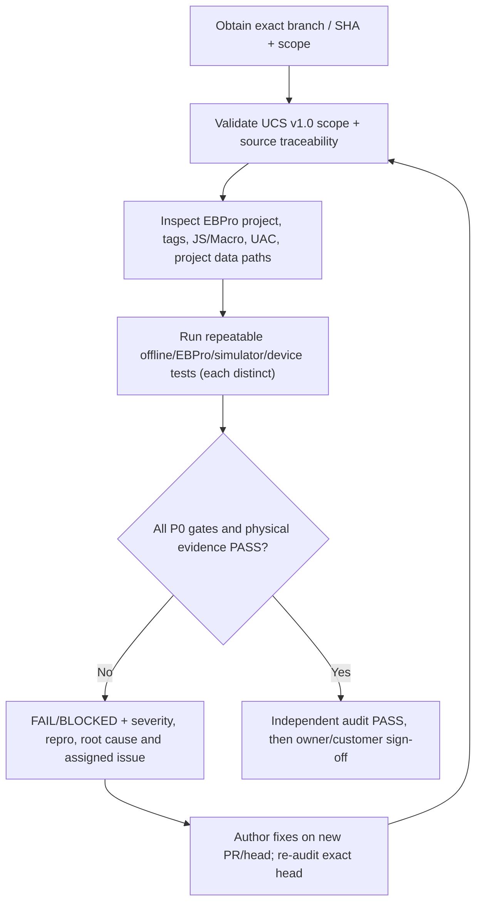

# UCS v1.0 — Independent AI Audit Protocol & Release Gate
**Audit issue:** [#30](https://github.com/raohassandev/Weintek-Macro-Javascript-based-reporting/issues/30). **Baseline:** [UCS Final Master Plan](UCS_FINAL_MASTER_PLAN.md). **Evidence matrix:** [Traceability](UCS_REQUIREMENTS_TRACEABILITY.md).
**Current baseline audit state:** NOT RUN; no independent approval claimed.

## Two distinct audits — no mixing of evidence
1. **PRE-IMPLEMENTATION PLAN AUDIT #38:** After plan #37 merges. Reviewer independent of plan author inspects frozen master plan, 1920×1080 UI, memory contract links, single USB/no SD case, Weintek feature claims, report viability decisions and blocked P0 risks. This audit may PASS design integrity with **hardware UNVERIFIED**, but must not claim deployment working. **Owner then authorizes implementation**.
2. **LATER PRODUCT / RELEASE AUDIT #30:** Requires actual EBPro project, exact Weintek device, real historian/backup/report/61-meter evidence and customer signoff. No design plan audit can substitute for it.
See [Plan Freeze](PLAN_FREEZE_PRE_IMPLEMENTATION_AUDIT.md). The original A01–A22 checklist below remains applicable at appropriate evidence level.

## Auditor identity / independence
Auditor does **not** author implementation code, resolve own audit findings as invisible private work, fabricate manufacturer confirmation, sign for physical tests or infer Weintek hardware PASS from Python/GitHub CI. Auditor reads immutable PR head, test logs, device firmware, executable EBPro project and explicit known unknowns, then produces a separate dated PASS/FAIL/BLOCKED report.

## Audit workflow


## Review checklist (each verdict with file/line or observed evidence)
| Gate | Verify | A finding is automatically FAIL/BLOCKED if |
|---|---|---|
| A01 Strict scope | Weintek-only acquisition, historian and report runtime on actual SVRX/FHDX | PC/IPC/Node/remote SQL/cloud processor dependency, even described as fallback |
| A02 Model/version | Exact back label/model/EBPro/OS and official support table | Feature claimed from different model (Basic/Advanced/SVRX/FHDX (W)) |
| A03 R&D reliability | 35+ indexed sources with exact official URL/version/date/conclusion/caveats; demos listed honestly | Claimed demo binary downloaded/compiled when only catalog inspected |
| A04 Tag collision | 61×128 LW proposed blocks, PLW/LB/RW/system reserved ranges and UAC/SQL controls checked vs actual project | Unbounded meter index, overlap, global LW index across clients, writes to reserved system tags |
| A05 Data formats | endian/signedness/float/counter/units/scales and unsupported tag handling | Arbitrary meter reg copied across brands, undefined value silently rendered 0 |
| A06 Runtime commissioning | can configure predeclared meter and rollback on actual HMI; rejects unsupported driver | Claimed hot driver/protocol install without EBPro support |
| A07 Session isolation | 2+ cMT Viewer users navigate separately and role restrictions survive direct access | Operator viewing or changing engineer-only settings due client PLW/global LW confusion |
| A08 Collector integrity | all meters captured regardless of viewed screen, measured throughput/quality | Historic source is same selected-LW buffer or capture stops when no page open |
| A09 Missing record evidence | meter no response vs interface/cable/network/device state vs HMI outage/media failure | No-data silently zero; confidently blames meter without evidence; unobserved uptime gaps erased |
| A10 Durability | target USB/SD/SSD actually writable, rotated and safe under disconnect/full/restore | USB connected bit alone marks recorder working; writes fail but UI stays green |
| A11 Storage/Backup | age-bound storage checks, earliest/latest persisted, measured forecast, verified independent backup/restore | Fake GB forecasts, checksum/restore untested, backup only on same physical disk |
| A12 Report correctness | native on-device date filters and reconciled energy/count/PF/duration, quality gaps | Sum(kW) as kWh; wrong local boundaries; report excludes missed intervals without warning |
| A13 HMI output boundary | CSV created on Weintek and verified; PDF/XLSX if demanded has actual on-device generator proof | EBPro PDF Reader presented as PDF creator; PC report service slipped back in |
| A14 JS/HTML | JS Object Canvas and browser/file HTML test truly supported on exact hardware | file:/// USB HTML claimed to work without real run; JS Object confused with browser DOM |
| A15 User purpose | Operator/Engineer/Manager homes show purpose-specific essential elements, common meter detail | Routine CPU/RAM taking space on management home; duplicated dashboards with role-only labels |
| A16 Alert semantics | role+severity popups deduped/acknowledged and events always persisted | Popup disappears with no history; all roles spammed for every condition |
| A17 Security | UAC, data and action-level protections; no hard-coded credentials; read-only default | Hiding a JS button alone protects writes/restore; credentials/customer logs in public repo |
| A18 Performance | screen jitter/stale/UI errors, HMI CPU/RAM, 61-meter poll, log write, simultaneous users measured | Synthetic “61 devices” test mislabeled production; screenshot with fabricated ‘real’ numbers |
| A19 Docs and recoverability | user guide, config export/import, backups, migrations, runbook, rollout rollback | Engineer cannot build/import from repo, or overwrite occurs without backup |
| A20 Release gates | 36 requirements traced to objective pass logs, independent reviewer and owner | “100%” from CI only or design-only completion |
| A21 Auditability | current issue flags, CI exact head, run logs, PR SHA, R&D source validity linked | Missing evidence links, stale contradictory live issues treated as approved |
| A22 Licensing/privacy | manufacturer manuals linked rather than redistributed by default, privacy preserved | Unlicensed proprietary demo/source files or sensitive site data leaked |

## Required test suites and negative cases
**Static/offline CI**: JSON Schema and reference integrity, unique tags/device IDs, memory bounds and float width, invalid address guards, role policy, no-PC config policy, HTML PoC isolation, chart/asset syntactic validation, report calculation fixtures, reset/gap/timestamp corner cases.

**Native EBPro**: exact project opens; macros parse/compile; JS Action/Canvas supported; Data Sampling object and SQL Query object configured; UAC tied to actionable controls; native tag CSV imported from exported EBPro template; alarms and files actual, including multiple Viewer sessions.

**Hardware acceptance**:
1. Physical meter-1 and meter-2; display one while other records, swap per-client screens; two different supported meter profiles.
2. Meter offline (1), repeated Modbus timeout, exception/partial loss, recovery, HMI shutdown and clock jump; all periods in events/coverage.
3. Disconnect USB/SD with site logging active; show disconnected+not-recording; read-only full/FAT32 file rollover and reconnect; no old success latched.
4. Record chronological event and kWh aggregate for 24h or customer-approved duration, verify exactly captured raw/CSV values; longer soak for 61.
5. Simultaneous at least two clients (representative actual supported mode) and background full 61 meter acquisition; monitor CPU/RAM/page freezes/poll lag with measured records.
6. Admin restore blocked for Operator/Manager; Engineer commissioning logged and unsupported device rejected safely.
7. Backup files opened/recovered on isolated media with checksums + timed restore drill.
8. SQL local SQLite, JS USB probe, PDF and embedded HTML tested **only** if those features are in final output; otherwise mark unsupported.

## Finding severity and reports
- **CRITICAL:** external PC/server introduced, uncontrolled device write or unprotected restoration, major record-loss misrepresentation, secret exposure.
- **HIGH:** data source misrouting, wrong energy calculation, off-device processing, invalid retention/backup claim, multi-user access leak.
- **MEDIUM:** missing alert debounce/coverage warnings, limited CSV formatting, storage forecast missing low-confidence state.
- **LOW:** minor label/style/layout defects with no operational impact.

**Every finding** must include `FINDING-ID | Requirement ID | Severity | status | exact SHA | affected file/object | expected vs observed | reproduction | mitigation | owner issue`. Audit PASS requires zero open P0 CRITICAL/HIGH findings and signed treatment of remaining severity; customer reporting/backup correctness must pass before release.

## Standard auditor output
```markdown
# UCS Audit Report — YYYY-MM-DD
Scope: PR # / head SHA / repo / exact model and firmware
Independent reviewer: ...
Verdict: PASS | FAIL | BLOCKED
Evidence levels assessed: DOC / OFFLINE / EBPRO / SIMULATOR / DEVICE / CUSTOMER
Must-pass gates: A01..A22 outcome + references
Evidence table by UCS-001..UCS-036: linked run/project/screenshot/log, NOT_RUN if absent
Critical/high findings with reproducible fixes, owner and recheck trigger
Project acceptance recommendation: GO / NO-GO / BLOCKED
Explicit note: whether another computer is required (must be NO)
Sign-off date / audit issue #30 link
```

## Audit rules
- R&D material should be checked against exact official manufacturer feature/version tables, not future-looking marketing. Vendor forum examples are contextual evidence, not universal capability.
- An audit of docs only may legitimately PASS as “**documentation consistency only**”, but cannot close #30 full independent system acceptance.
- The current automated GitHub CI suite validates configuration/design and assets, **not** the real EBPro, storage media or project historian.
- No reviewer should pressure owner to manually execute long sequences. AI/engineer collects instrumented evidence; ask owner for a physical model fact only when essential.
