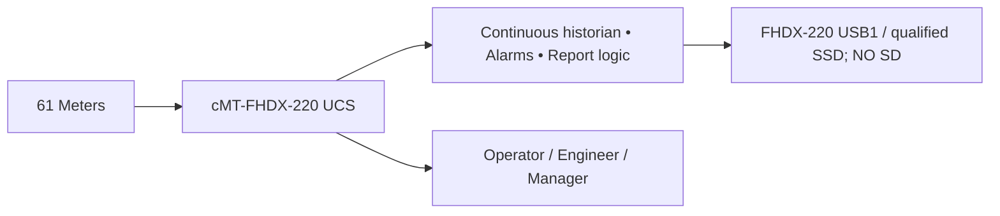

# UCS — one-page owner dashboard (Weintek ONLY)

**LATEST UI DIRECTION:** Owner rejected generic visual demos. Main plant screen = **REAL site-specific SLD**, not fixed generic cards. One shared Weintek FHDX-220 SLD with role-based actions; per-meter detail/trends/report pages remain. **Cannot draw it before actual electrical plant SLD and meter-to-feeder mapping are supplied**. Existing old preview PNGs are superseded, not approved. [SLD contract](PLANT_SLD_PRIMARY_SCREEN_CONTRACT.md) · [Issue #43](https://github.com/raohassandev/Weintek-Macro-Javascript-based-reporting/issues/43).

**Planning freeze PR #39 review, then independent plan audit #38; implementation ON HOLD.** [External audit findings](PLAN_AUDIT.md). **Baseline v1.0 (not hardware-deployed):** [Main Plan](UCS_FINAL_MASTER_PLAN.md) · [AI Handoff](AI_AGENT_EXECUTION_BRIEF.md) · [Acceptance](UCS_REQUIREMENTS_TRACEABILITY.md) · [Work Packages](UCS_DELIVERY_WORKPACKAGES.md)
Aap ko lambi technical reports nahi parhni; yeh 1 screen ka status aur decisions hain. [CC #1](https://github.com/raohassandev/Weintek-Macro-Javascript-based-reporting/issues/1) · [Diagram](VISUAL_PLAN.md) · [Role home UX](ROLE_BASED_UX_PLAN.md) · [HTML R&D](../research/WEINTEK_HTML_FEASIBILITY.md).

## Our implementation boundary
**61 energy analyzers**, **Weintek cMT-FHDX-220**, **USB1/qualified USB-SSD; NO SD slot**. **No additional computer/server.** Site meter brand, register map, energy units, thresholds and retention are configurable.

## Who sees what?
- **Operator:** 61 meter overview, current electricity flow, active actionable alarms.
- **Engineer:** connectivity faults, device diagnostics, commissioning and maintenance.
- **Manager:** energy KPI, date comparisons, report preview, business-impacting exceptions. Storage utilization is **not** always on this screen.
- **Shared windows:** one indexed meter detail, common trends/reports, deep Resource & Storage Manager.
- **Critical exception:** role-directed popup + persistent event log; routine notices do not spam management.

## HTML result: 3 features, not one
- **JS Object Canvas**: supported customizable visuals in EBPro; NOT arbitrary HTML page execution. **Preferred** for rich UCS views.
- **PLC Web Browser**: explicitly **NOT supported on selected FHDX-220** (the manufacturer matrix lists FHDX-820). USB HTML is not a 220 implementation route.
- **cMT-FHDX-820 (W)**: different Weintek HTML5 Web Panel with Chromium. It is not automatically a native EBPro historian; without approved source/Weintek-only data bindings, do not switch to it.
- EasyWeb/WebView **remote HMI rendering**, not custom HTML server.

## Recent real work (2026-10-13)
- Previous source packs: light-theme management screen SVG, background PNG, object map and register dictionary, USB file test JS; these are *engineering assets*, not fully loaded EBPro project.
- New correction: no PC/IPC; role-specific homes, alarm routing, Weintek demo catalog, [HTML offline experiment](../experiments/html-poc/index.html), pending acceptance.
- Real meter/acquisition, USB HTML, physical HMI file writing, 61-device performance, report completeness **NOT YET ACCEPTED**.

## Human input when needed
Exact FHDX-220 model already selected; EBPro/firmware details only when required for post-audit hardware validation; engineering handles vendor manuals, tests, code and board. Do not ask user to type long test logs.
