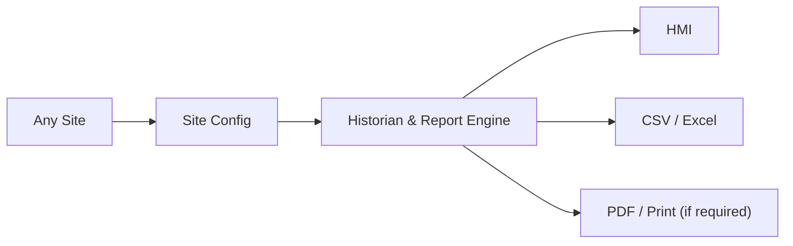

# Owner quick view — Weintek Universal Historian
**Aap ke liye 1-page overview. Detailed R&D aur tests engineer ki zimmedari.**
[Live CC](https://github.com/raohassandev/Weintek-Macro-Javascript-based-reporting/issues/1) · [Diagram](VISUAL_PLAN.md) · [Report types](REPORT_CATALOG.md) · [R&D library](../research/INDEX.md)

## Project ka maqsad
Ek **universal site-configurable reporting system**: solar site, factory, UPS, LPG, HVAC waghera mein engine same; site devices, tags, data interval, report formula aur output selection alag.

## Owner ko kya dikhega?
- **Preview:** Select site → date → report → preview → export.
- **Choices:** HMI model available? Report ka output screen / CSV / formatted PDF?
- **Progress:** Sirf `Done / Working / Blocked` with evidence links. No pages of logs.
- **Product logic:** Site changes → **config change**, not new application.

## Features catalog — not yet delivered
Read-only history, trend, daily/monthly summary, energy import/export/generation, alarms, equipment uptime, shift/production, batch transactions, process/environment, UPS outages, data quality and custom filters. [All 22 planned templates](REPORT_CATALOG.md).

## Current reality (2026-10-13)
- ✅ R&D organization, diagrams, generalized requirements are being established.
- ⏳ cMT3102X and other Advanced model features need exact physical verification.
- ⚠️ `cMT1102` label ambiguous, `cMT1106X` Basic not a reliable SQL/JS query option.
- ❌ No actual HMI testing, deployable report engine, live historical export or customer signoff yet.
- ⚠️ Weintek local SQLite SQL Query support is documented; **Advanced custom SQL on local SQLite** is *not assumed*. Older manuals explicitly describe Advanced Mode for MySQL/MS SQL; this combination needs a direct test or current manufacturer answer.

## Ek waqt mein sirf do owner decisions, jab zaroori hon
1. Available HMI ka exact rear-label model / EBPro version (photo chalegi).
2. Customer ko **sirf HMI + CSV**, ya **formatted PDF/print** bhi chahiye?
Everything else: Research, examples, fixtures, formula validation, docs and GitHub task tracking are engineering's responsibility.
