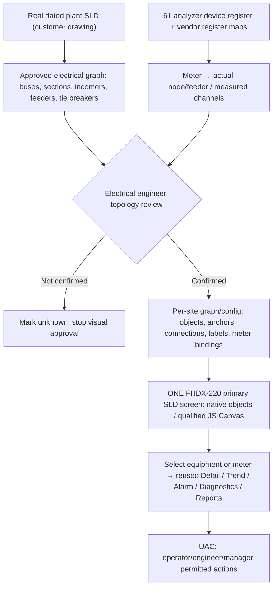

# UCS — Site-Authentic Plant Single-Line Diagram (SLD) Design Contract
**STATUS: NEW OWNER DIRECTION / NOT YET DRAWN OR APPROVED.**
**Supersedes:** generic role-home dashboard visual previews from PR #41 (110/120/130) as approved production designs. Files retained as rejected concept/history; **do not implement, reuse screenshots as live HMI, or present them as accepted UI**.
**Owner instruction:** A *real plant SLD* occupies **one primary UCS main screen**. Do not invent plant topology or draw decorative power-flow without electrical sources and measured signals. [Issue #43](https://github.com/raohassandev/Weintek-Macro-Javascript-based-reporting/issues/43) · [FHDX-220 hardware](HARDWARE_TARGET_FHDX_220.md).

## 1. Platform and architecture: settle Web vs Weintek
- **Runtime target:** Weintek **cMT-FHDX-220**, only; **native EasyBuilder Pro objects** plus version-qualified **JS Object Canvas** if needed for rendering symbols/lines. Screen designed to native 1920×1080 project resolution, no generic web-page prototype.
- A remote web/browser client, if supported by the exact Weintek/cMT Viewer/WebView version, can **view the native HMI**; that is a presentation client, not a separate HTML/CSS/React SCADA application or server. Remote access/security requires model/OS proof.
- **PLC Web Browser is not documented for this FHDX-220** and `file:///usb/index.html` is no release route. Never introduce a separate runtime PC/IPC/Node/web server.
- One reusable **SLD screen/renderer** is the generic software component, but **plant topology and symbol placement are unique site configuration**. Support different site graphs, meter models and connection count. Not one hard-coded electrical line diagram for all customers.
- Whether cMT-FHDX-220 JS Object can *load a new site layout directly from removable media/recipe at runtime* is an open manufacturer/bench check, **NOT proven**. If dynamic file binding unsupported, updating SLD geometry may still require building/downloading an EBPro project. Never promise fully no-EBPro commissioning until feature proof.

## 2. Required site source — not yet received
**Cannot draw an authentic SLD from "61 energy analyzers" alone.** Minimum source:
1. The real site electrical SLD (PDF/DWG/DXF/clear scanned drawing, with revision/date; **don't copy into public repo if confidential**).
2. Device/equipment IDs exactly as onsite: utility incomers, transformers, HT/LT buses, bus couplers, breakers/ACBs, substations/sections, feeders, solar/generator/UPS *only if actually present*.
3. Meter **01..61 → actual electrical node or feeder** mapping with label and location; for any unknown, explicitly `UNMAPPED` rather than guessing.
4. Available breaker ON/OFF and healthy/stale signals; source active power/energy/direction tags *only where metered*; do not infer switch status from kW sign or proximity.

Collect the actual plant drawing first. Engineer then creates a reviewed **topology manifest** and tags registry. HMI implementation and visual preview wait until source verified.

## 3. SLD information architecture (not a fictitious plant topology)

**Topology** is config data; **renderer/reusable meter-detail logic** is generic. No screenshots of imaginary factories or solar farms.

## 4. Recommended SLD scene/state contract
| Layer | Content | Data/source | Hard rule |
|---|---|---|---|
| 0 Site geometry | Actual buses, incomers, feeders, equipment symbols, connectors | Engineer-approved site SLD + per-site coordinates | Geometry never derived from decorative dashboards or KPI values |
| 1 Switch status | True OPEN/CLOSED/UNKNOWN, manual/auto if supplied | Actual discrete breaker/PLC/meter tags | **UNKNOWN** when tag absent, stale or conflicting; no invented state |
| 2 Measurements | A few high-value validated kW/A/V/PF/energy readings on relevant nodes | Bound metric IDs, units, scale, timestamp, quality | Show compact live value; do **not** force 61×maximum data on one screen |
| 3 Flow direction | Optional arrows/animation only with proven direction/power availability | Valid data & sign policy at specific source/feeder | Suppress on no data, ambiguity and stale states; no animation without physics |
| 4 Fault & quality | Alarm badge, communication status, source age, data gaps | Persistent Event Log + quality ledger | Missing meter does not imply feeder de-energized |
| 5 Interaction | Click/touch equipment, highlight path, open common details | Per-client selected node/meter + UAC | No viewer cross-talk, no Modbus write from drawing without explicit safe workflow |
| 6 Roles | Operator/Engineer/Management contextual commands + relevant alarm | Role and site permission policy | Same site SLD geometry, role-specific permitted interaction; extra pages optional, not primary |
| 7 Navigation | Meter Detail 210, Trends 220, Reports 310, Diagnostics 410, Resource 510 | Shared HMI windows | No 61 duplicated detail windows; native history independent of selected screen |

## 5. Site-manifest model (PROPOSAL, not EBPro import format)
```json
{
  "site_id": "<real_site_reference>",
  "sld_revision": "<drawing_revision>",
  "canvas": {"width": 1920, "height": 1080},
  "nodes": [
    {"id": "<equipment_tag>", "kind": "<bus|breaker|incomer|feeder|transformer|meter|other>",
     "label": "<actual_name>", "x": null, "y": null, "state_tag": null,
     "meter_id": null, "capabilities": []}
  ],
  "links": [
    {"from": "<real_node_id>", "to": "<real_node_id>", "kind": "<electrical_connection>",
     "verified": false}
  ],
  "approved_by": null,
  "approval_status": "SOURCE_DRAWING_PENDING"
}
```
Coordinates only after rendering the **approved source SLD**. A site-agnostic schema can validate IDs, bounds, links and role binding, but cannot independently validate electrical correctness without engineer review.

## 6. Quality/performance and operating constraints
- 61 live analyzers continue background polling/history regardless of which SLD element is highlighted. 61 meter values need not all be visible simultaneously.
- Draw static geometry once; update dynamic badges/numbers at a documented cadence, not busy-loop regenerate 61 Canvas objects per frame. CPU/RAM proof on actual FHDX-220 required.
- Dense plants may need navigation to substations/areas and meter detail to be legible at 1920×1080; the **top-level plant SLD remains one main screen**. Any zoom/pan/sub-view must be proven with EBPro object type and touch limitations.
- Use configurable equipment drawing IDs and data bindings rather than writing `LW` addresses directly into graphic code; all typed normalized register blocks stay per meter with independent private viewer selection.
- Safety: rendering is **read-only by default**. Do not visually imply energization, protective relay trips, export, closed breaker or flow direction from assumptions.
- Recording and data-quality alarms are independent of SLD UI. USB1, backup and memory details stay in Resource Manager—not crowded into the electrical diagram.

## 7. Gate for a realistic preview
1. **P0** Owner supplies actual (preferably up-to-date) plant SLD drawing and meter/equipment map or authorizes an engineer to obtain it.
2. Validate graph nodes/edges, connection hierarchy and source categories; mark any unresolved facts instead of inventing.
3. Show **one faithful schematic prototype** based on the real source, with only confirmed symbol states and placeholders `—/NO DATA` where signals unknown.
4. Owner/plant electrical engineer approves topology and visual hierarchy.
5. Independent **GATE-1 design-change addendum review** since the previous GATE-1 PASS applied to the earlier SHA/requirements. No EBPro compile or deployment until hardware System Info, EBPro version and explicit implementation permission.

## 8. Consequences for previous artifacts
- `designs/screens/110-operator-home`, `120-engineer-home`, `130-management-home` from PR#41 are **REJECTED VISUAL CONCEPTS**. Keep only as archival examples of file packaging (preview/background/CSV docs), never as target or proof of SLD approval.
- Generic data/report/diagnostics/resource page capability and previously documented historian quality/single-USB constraints remain requirements. The **visual home-screen hierarchy** is superseded by the shared site-authentic SLD main.
- Until the actual SLD is received, status **[BLOCKED: real plant electrical drawing and verified meter-to-feeder mapping]**.
