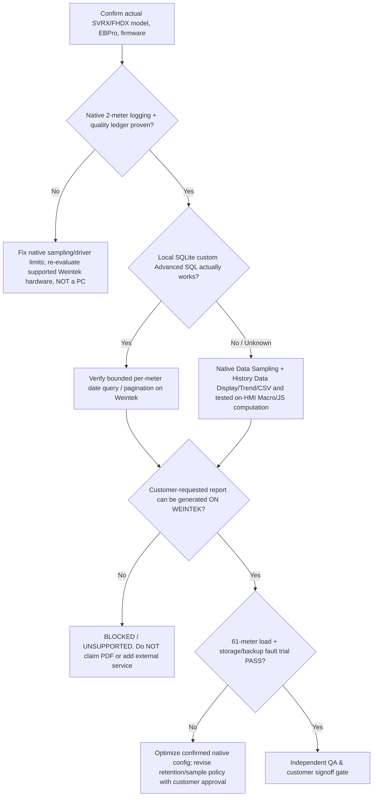

# UCS v1.0 — External Plan Audit & Corrective Action Register
**Reviewed:** 2026-10-13. **Authoritative repository baseline:** [UCS_FINAL_MASTER_PLAN.md](UCS_FINAL_MASTER_PLAN.md). **Owner scope:** Weintek SVRx/FHDx **only**, no extra PC/IPC/server. [CC #1](https://github.com/raohassandev/Weintek-Macro-Javascript-based-reporting/issues/1).  
**Audit provenance:** findings supplied by another AI/human in the current project conversation; this response independently rechecked relevant GitHub files, current v1.0 structure, initial CI and official Weintek SQL manual, but has **not** run physical HMI tests. Auditor claim about 21 cross-links should not be turned into a new test PASS without rerunning the same exact check.

## Verdict and what was actually audited
- **Plan baseline/design:** documents, issues, schemas and tests exist. Previous exact-head baseline CI [#38365571787](https://github.com/raohassandev/Weintek-Macro-Javascript-based-reporting/actions/runs/38365571787) PASS; no real EBPro project/device evidence.
- **Main correction to external audit:** auditor described `docs/MASTER_PLAN.md` **old M0–M5 / R01–R14**. That file is now an intentionally superseded redirect. Current canonical source has **M0–M6**, **36 UCS requirement IDs**, **12 parallel work packages**, **22 independent audit gates**. Thus recommendation for milestone status remains valid, but belongs in the **current plan**.
- **Device proof:** nothing is DEVICE-PASS or CUSTOMER-ACCEPTED. Do not confuse status tags such as [COMPLETED PR#31] (planning documents) with a working SCADA.
- **P0 genuine constraints:** exact SVRx/FHDx SKU/OS/EBPro, 61-meter native logging and storage, accepted report output, dynamic SQL/SQLite behavior; no silent PC/IPC fallback.

## Findings and actions (external report reconciled)
| Finding | Severity | Observed / limitation | Fix or resolution | Evidence state | Owner issue |
|---|---|---|---|---|---|
| AF-01 — No device proof | **P0 BLOCKED** | Real SVRx/FHDx, SQL, USB and 61 devices not tested; most work research/design | Record exact model+OS+EBPro and build 2-meter EBPro vertical slice before scale | NOT RUN — hardware | [#2](https://github.com/raohassandev/Weintek-Macro-Javascript-based-reporting/issues/2), [#28](https://github.com/raohassandev/Weintek-Macro-Javascript-based-reporting/issues/28) |
| AF-02 — Missing live milestone flags | P1 | Old plan M0–M5 retired, current v1.0 M0–M6 had no status column | Live milestone status table in current master plan and WP0–11 tracker; CC stays authoritative on latest run | DOC UPDATE / CI REQUIRED | [#33](https://github.com/raohassandev/Weintek-Macro-Javascript-based-reporting/issues/33) |
| AF-03 — Advanced Local SQLite custom SQL unknown | **P0 BLOCKED** for arbitrary custom SQL | Official Weintek SQL Query Local source USB/SD SQLite documented; Advanced SQL command description specifies MySQL/MS SQL, so custom `SELECT` on Local SQLite not proven | Bounded local DB test on exact supported Weintek SKU; vendor written clarification; if fails, test independent native History Data Display + CSV/report processing **on HMI**, custom SQL report remains BLOCKED | MANUFACTURER DOCUMENTED (local database), CUSTOM SQL DEVICE-PROOF NOT RUN | [#3](https://github.com/raohassandev/Weintek-Macro-Javascript-based-reporting/issues/3) |
| AF-04 — Customer output unspecified | **P0 DECISION** | Daily/period HMI/CSV route proposed but signed contract for PDF/XLSX not established | Request approval of HMI + CSV first vs branded PDF/print mandatory; if mandatory PDF cannot be generated on device, explicitly mark UNSUPPORTED, contract/change-control decision needed | CUSTOMER OUTPUT TBD | [#8](https://github.com/raohassandev/Weintek-Macro-Javascript-based-reporting/issues/8) |
| AF-05 — Old PC/IPC fallback conflict | **P0 ARCH-SCOPE** | D-006/D-014 historical external-report/SSD suggestions contradict owner-enforced D-018 | D-018 wins. Weintek HMI + qualified attached USB/SD/USB-SSD only; measure actual 61-meter capacity and backup/restore. If hardware insufficient, reselect suitable **Weintek-only** hardware/interval or report BLOCKED; never add hidden PC/IPC | POLICY DOCUMENTED, STORAGE/RUN-TIME UNTESTED | [#18](https://github.com/raohassandev/Weintek-Macro-Javascript-based-reporting/issues/18), [#17](https://github.com/raohassandev/Weintek-Macro-Javascript-based-reporting/issues/17) |
| AF-06 — No energy-calculation golden cases | P1 | Rules existed but test data for counter resets, unknown drop, rollover, missing vs zero and kW integration was missing | Add synthetic JSON expected-vs-observed fixtures + dependency-free Decimal reference and negative tests; translate verified semantics to Weintek Macro/JS later | OFFLINE TEST IN PR / HMI NOT RUN | [#34](https://github.com/raohassandev/Weintek-Macro-Javascript-based-reporting/issues/34), [#9](https://github.com/raohassandev/Weintek-Macro-Javascript-based-reporting/issues/9) |
| AF-07 — PDF + long-retention architecture still open | **P0 CAPABILITY** | Weintek-only constraint forbids previous convenient off-device service; no proven arbitrary report/PDF generator | Run feasibility gates below; only promise verified native features; if PDF is a contractual MUST and no native path, product cannot pass acceptance without owner's explicit scope change | OPEN | [#8](https://github.com/raohassandev/Weintek-Macro-Javascript-based-reporting/issues/8), [#18](https://github.com/raohassandev/Weintek-Macro-Javascript-based-reporting/issues/18) |
| AF-08 — User input TBD | P1 | Model/firmware, meter types/tag maps, polling, retention, report format, branding, authority remain TBD | Site commissioning questionnaire **not sent as long form**; collect single essential facts at the relevant gate; keep remaining specs explicitly TBD | OPEN / stage dependent | [#2](https://github.com/raohassandev/Weintek-Macro-Javascript-based-reporting/issues/2), [#28](https://github.com/raohassandev/Weintek-Macro-Javascript-based-reporting/issues/28) |

## Technical decision tree — strictly HMI-local runtime

### Q02 is not synonymous with "all reporting"
The **custom SQLite SQL path** has a critical risk, but it does **not** erase official native Trend Display/History Data Display/Data Sampling and file-backup features. Native basic reporting might be viable without Advanced Mode; complex SELECT/joins/long-run aggregation are NOT automatically viable. A design fallback is only valid when the on-device feature is proven (not a mere promise).

**Manufacturer evidence:** [EBPro V6.01.02 release notes (Local SQLite USB/SD)](https://dl.weintek.com/EBPro/ReleaseNote/EBProV60102_ReleaseNotes_en.pdf) and [EBPro 6.10.01 SQL Query object manual](https://dl.weintek.com/public/EBPro/UserManual/eng/UserManual_separate_chapter/Chapter-13-Objects-UserManual-eng.pdf). Manual explicitly describes Advanced Mode custom SQL in MySQL/MS SQL terms; do not extrapolate that as Local SQLite support.

## Energy reference fixture scope and quality boundary
`tests/fixtures/energy_reference_cases.json` + `scripts/energy_reference.py` + `tests/test_energy_reference.py`. 12 synthetic cases:
- true cumulative counter deltas vs typed values;
- explicit reset: skip unknown crossing interval instead of splicing values;
- rollover only when marker and configured modulus present;
- unexplained counter decrease is a **hard error**, not negative consumption;
- kW trapezoidal integration with exact elapsed time and no long-gap interpolation;
- zero GOOD value distinct from null/COMM_TIMEOUT;
- monotonic cumulative counter can recover aggregate kWh across comm loss, but distribution into hourly/daily bins is UNKNOWN;
- explicit UTC offset/timezone and signed kW direction requiring project policy.

The included code is a **reference oracle for offline verification only**. It is **not a Weintek Macro**, executable EBPro JS Object or native SQL test. Do not claim plant energy calibration from its success.

## Work priority after audit fix
**Parallel whenever possible:** #2 model/version proof and #3 vendor SQL clarification; #34 fixture building; #15/#16 reusable addresses/roles; #17 historian quality. Prioritize actual 2-meter reproducible native pilot #28 before large 61-meter acceptance. Customer report-output decision #8 must be resolved before promising branded PDF. Retention sizing from measured 61-meter data #18 remains P0. Independent audit #30 and release #10 cannot close from docs-only PRs.

## What another AI must report
For each audit item: finding ID, exact PR/head SHA, CI test URL and status, hardware evidence (or NOT RUN), owning issue, next step. [Master execution handoff](AI_AGENT_EXECUTION_BRIEF.md) and [36 requirements](UCS_REQUIREMENTS_TRACEABILITY.md) stay authoritative. The owner should only be asked for a photo of target SVRx/FHDx model and actual software version when physical integration begins, then one output-format decision as needed.
