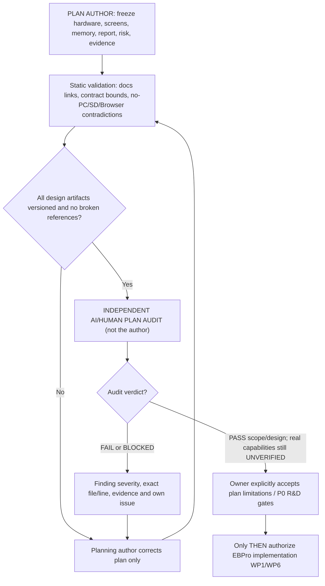

# UCS — Design Plan Freeze & PRE-IMPLEMENTATION INDEPENDENT AUDIT GATE
**Target:** Weintek **cMT-FHDX-220** (selected). **Scope:** one site, 61 configurable energy analyzers, 3 user roles, 22 report-template concepts. **Date:** 2026-10-13.
**Single-USB safety:** historian storage/backup conflict and touch input need physical verification; no SD slot.\n**Status terminology:** A plan can be **DESIGN-FROZEN FOR AUDIT** while product feasibility remains **BLOCKED / DEVICE NOT RUN**. Independent audit **must occur after plan documentation lands and before implementation is authorized**. Do not claim 100% project complete.

## Reported GATE-1 result (2026-10-13)
[Owner-relayed independent plan audit](GATE1_INDEPENDENT_PLAN_AUDIT_RESULT.md) at frozen SHA `a22eeeebe1e4ded14219b497de30f5ffd9cedf90` reported **PASS DOC/OFFLINE**. Does NOT mean device firmware/SQLite/storage/PDF success nor owner permission to code. Physical system and actual FHDX-220 System Info + EBPro remain blocking #28/#29. The next agreed tasks are limited to source-traceable static screens and 2-meter **specification**, not compiled EBPro.

## Governing decision / authority
- No computer/IPC/Linux box/external SQL/Node/cloud processor in runtime; only native supported Weintek firmware/EBPro and passive USB storage. Existing cMT Viewer clients may view but cannot be mandatory report processors.
- Primary hardware is cMT-FHDX-220 with **ONE USB2 host, NO SD/microSD, max HDMI 1920×1080**. Earlier SVRX/FHDX-820 designs are contextual only. A legacy/discontinued procurement concern is a documented risk, **not an implicit upgrade decision**.
- JS Object Canvas + native EBPro objects are target UI, not HTML file/browser. PLC Web Browser is documented for FHDX-820, **not selected 220**.
- ALL 61 meter acquisition/historian source independent of current window/meter selection; separate per-client PLW view state, actual multi-viewer validation required.
- Missing values/communication failures/storage failure create traceable quality and downtime intervals; never represent missing data as 0 and don't claim meter guilty from a recorder outage.
- SQL Query object model documentation is evidence of availability, **not** proof of Advanced Mode arbitrary custom SQL on Local SQLite or direct JS SQLite database API. PDF Reader ≠ generator.
- Resource Manager is a deep diagnostic/admin window; routine management home only shows reports/KPIs and *material exceptions*.

## Integrated engineering documents an auditor must read
| Group | Canonical file(s) | Freeze check |
|---|---|---|
| Source of truth / chronology | [UCS master](UCS_FINAL_MASTER_PLAN.md), [Project context](PROJECT_CONTEXT.md), [Decision log](DECISION_LOG.md) | D-018 no-PC supersedes old alternatives, D-028 FHDX-220 selected |
| Hardware capability & procurement | [220 model spec](HARDWARE_TARGET_FHDX_220.md), [hardware JSON](../contracts/hardware-target.json) | No SD/Browser/unsupported 820 references treated as 220 |
| Screens | [1080p Screen Design Brief](SCREEN_DESIGN_BRIEF_FHDX220.md), [Role UX](ROLE_BASED_UX_PLAN.md), [Resource spec](RESOURCE_STORAGE_MANAGER_SCREEN.md) | Each role home purpose-complete, native object proof, 1920×1080 |
| Shared meter / tags | [Dynamic screen design](DYNAMIC_SCREEN_ARCHITECTURE.md), [memory contract](WEINTEK_MEMORY_CONTRACT.md), [meter-map JSON](../contracts/meter-memory-map.json) | 61×128 LW range 256..8063, client-private selection, no system collision assumption |
| Historian / quality / reports | [22 report catalog](REPORT_CATALOG.md), [requirements](UCS_REQUIREMENTS_TRACEABILITY.md), [audit findings](PLAN_AUDIT.md) | Native 61-meter source, gaps and report no-data, CSV candidate only |
| Storage | [Single USB safety design](FHDX220_SINGLE_USB_STORAGE_RISK.md), [storage plan](STORAGE_DECISION_AND_CAPACITY.md), [resource register sources](../tags/resource-manager-dictionary.csv) | No simultaneous backup claim; 4GB Flash not a guaranteed history quota |
| Weintek R&D | [Research index](../research/INDEX.md), [source register](../research/SOURCE_REGISTER.json), [official demos review](../research/DEMO_PROJECTS_REVIEW.md), [HTML limitations](../research/WEINTEK_HTML_FEASIBILITY.md) | Distinguish manufacturer evidence from demo/physical test |
| Process and QA | [Work packages](UCS_DELIVERY_WORKPACKAGES.md), [Agent handoff](AI_AGENT_EXECUTION_BRIEF.md), [Independent audit protocol](INDEPENDENT_AUDIT_PROTOCOL.md), [owner dashboard](OWNER_DASHBOARD.md) | No implementation before approved independent plan audit |
| Audit reference fixtures | [synthetic energy cases](../tests/fixtures/energy_reference_cases.json) (if merged), offline tests | Expected vs observed kWh rule, reset, rollover, null, comm gap, timestamps |

## Prior external audit reconciliation
The supplied reviewer correctly found lack of hardware evidence, questionable local SQLite Advanced SQL, unspecified PDF contract and 220 single USB constraint. **Live GitHub main after PR #36** already includes FHDX-220 hardware facts. Its local workstation main being at #26 is a *sync state* only—do not change GitHub truth from an outdated local clone. [Audit remediation PR #35](https://github.com/raohassandev/Weintek-Macro-Javascript-based-reporting/pull/35) was previously green but remained **OPEN**; integrate its findings and synthetic fixtures into the final planning PR without overwriting newer 220 specification, or close it only when a real equivalent merge exists.

### Four unresolved P0 feasibility/contractual gates
1. **HMI software identity:** model chosen (cMT-FHDX-220); actual OS/firmware, installed EBPro version, 220 Private Index/UAC and JS/SQL feature behavior still unknown.
2. **SQL history/reporting:** test Local SQLite against bounded SQL Query Basic/Advanced on real 220. If Advanced fails, consider independently verified native Trend/History/CSV; complex queries remain BLOCKED. **Never** invent a PC fallback.
3. **One-port logging and backup:** prove real 61-meter capture and independent verified backup under touch-port/storage constraints. Candidate internal-history→USB archive has **not** passed endurance/capacity tests.
4. **Customer-approved output:** HMI history/CSV candidate vs mandatory branded multi-page PDF/print remains explicit customer decision. If native generation cannot meet a mandatory contract, mark incompatible before build/commit.

## Audit-first two-gate workflow

## Non-negotiable audit package format
Auditor is assigned a **single immutable commit SHA and PR links**. Auditor checks [36 UCS requirements](UCS_REQUIREMENTS_TRACEABILITY.md) in scope, [22 criteria](INDEPENDENT_AUDIT_PROTOCOL.md) for **plan quality only**, technical Weintek constraints, diagrams, schema math and link integrity. Every unresolved firmware/SQLite/storage/PDF item must remain an explicit execution-gating P0 item with owner and test, not silently called resolved. Provide PASS / FAIL / BLOCKED per item and finding IDs. A plan audit PASS does **not** mean product/device PASS.

**Independence:** Plan author must not submit “Independent audit: PASS” for own plan. Ask a distinct reviewer/AI agent and collect real review comment/report tied to exact SHA. Do not start implementation work during review. Owner approves start only after addressing all Critical/High plan contradictions and documenting the contractual blockers' disposition.

## Procurement/lifecycle decision
FHDX-220 may be an older/discontinued product according to distributor research; **do not change hardware** without new owner permission. If an existing 220 unit is functional/supportable, proceed to its physical feasibility gate *after plan audit*. If 220 must be procured and support/stock is unavailable, record [BLOCKED: hardware availability], show owner 220-vs-820 Weintek-only change proposal; 820's microSD/browser features do not automatically make native PDF or 61-meter SQL proven.

## Local engineer sync note (not performed by ChatGPT)
GitHub main contains PR #36 model updates; a separate engineer's local clone showing old #26 needs a normal Git fetch/pull. This is **not a new source-of-truth** and does not prove the assistant accessed that local Mac. Before pulling, save/commit/stash local changes, then `git fetch origin && git switch main && git pull --ff-only origin main`, compare `git rev-parse HEAD` to GitHub main. Use a clean branch for a new design PR.
