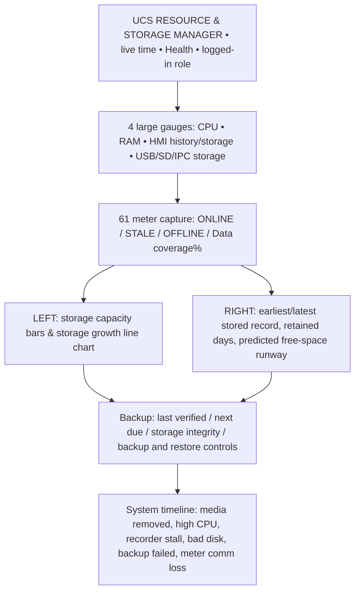

# UCS — Resource & Storage Manager (ONE reusable global window)
**Target:** cMT-SVRX-820/822 / cMT-FHDX-820 cMT Viewer; 1920×1080 design target (actual EBPro resolution chosen after hardware screen tests). **Status:** visual/functional specification, *not* a loaded .emtp/.cmtp EasyBuilder Pro project. [Feature issue #19](https://github.com/raohassandev/Weintek-Macro-Javascript-based-reporting/issues/19).

## Operator-friendly full-screen layout


### Large panels with data provenance
| Panel | Gauge/chart | Live data source | Caveat |
|---|---|---|---|
| CPU (instant) | donut & sampled 24h line | HMI `LW-9025`, 16-bit CPU loading x100%; optional `LB-12360` CPU high alarm | Check exact percent interpretation on model; 24h curve requires own background sampling |
| Memory utilization | donut + used/free | `LW-11159` 16-bit memory loading x100%; `LW-11155` 32bit total size KBytes and `LW-11157` 32bit free KBytes | HMI memory is RAM, not FLASH disk; use 32-bit objects |
| Internal FLASH / HMI history | capacity/free segmented bars | `LW-9072` 32-bit free KB; `LW-11458` 32-bit total **HMI history reservation** KB, `LW-11460` 32-bit free history KB; `LW-12829` available history KB | Manufacturer distinguishes flash vs allocated historian quota; don't show these as 4GB flash full-size percentage |
| USB1 FAT32 | media present, free KB, warning | `LB-12048` USB1 exists, `LB-9037` low space, `LW-9076` 32bit free KB | TRUE used% needs validated **total current partition**; `LW-12496` is *last detected* USB partition GB, not guaranteed current; match partition identity first |
| microSD | present, free KB, warning | `LB-12050` present, `LB-9036` low space, `LW-9074` 32-bit free KB | Same capacity/identity check |
| HMI general free-space alarms | icon + threshold event | `LB-9035`, `LB-9036`, `LB-9037` | Manufacturer warning near low free space; threshold/value version dependent |
| USB-attached SSD (optional) | optional storage bar & SMART-health panel | HMI system tags and scoped USB/media IO probe when compatible | USB SSD hardware/SMART data cannot be assumed available from Weintek system tags; show N/A until proven |
| Site capture | online/stale/offline/dropped events/coverage | 61-meter collector/historian quality ledger | Must include timestamps, report missing as a distinct event, no 0 substitution |
| Data retention | earliest/latest history, date-range timeline and space runway | storage database queries + measured growth | These are **derived**, not Weintek native system tags |
| Backup | last successful vs **verified**, next due, progress/size/result | application backup job manifest and checksum | HMI native backup integration must be version-tested |
| Alarms/events | scrolling incident timeline | system quality, media & recorder events | No fabricated events; set time source/ordering |

## UI behavior
- Initial page overview is **read-only** for operators. Engineer sees diagnostics; manager sees retention and reporting; manufacturer/admin has storage target/backup policy and guarded restore.
- Unsupported capability `NO_SOURCE` / hardware not installed should display `N/A`, not zero or green. USB missing: show `DISCONNECTED`, stop free-space display and record outage start/end.
- GUI load aims for sub-second *appearance* where possible; any update throughput claims require actual SVRX tests. Poll system registers at modest configurable interval (e.g. 2–5s; not every repaint), history aggregation less frequently (e.g. min 60s), optional 24h charts from explicit sampled historian data.
- CPU and RAM percentages are raw vendor registers; end-user percent scaling is **confirmed after OS check**.
- Numeric gauges have text readouts and saturation; health states: NORMAL / HIGH / CRITICAL / UNAVAILABLE. Provide colorblind-safe labels in addition to colors.
- Auto-refresh never blocks user backup/export; backup requests async state machine `IDLE → PRECHECK → SNAPSHOT → COPY → VERIFY → COMPLETE/FAILED`.
- For HMI-only screen, do not imply independent IPC SSD; render the USB section only if its source exists. Optional USB-SSD section only when physically detected AND supported; no external computer allowed.
- Viewer sessions and page selection do not start/stop background logging, which continues 61-meters independent of any screen.
- Screens are concept designs; illustrated demo numerical values are **not live data**.

## Suggested logical bindings / config
```yaml
screen_id: UCS_RESOURCE_MANAGER
model_mode: site_global # no 61-way screen duplication
metrics:
  cpu_pct:     {source: HMI_LW_9025, datatype: uint16, scale: verify_on_device}
  ram_pct:     {source: HMI_LW_11159, datatype: uint16, scale: verify_on_device}
  ram_total_kb: {source: HMI_LW_11155, datatype: uint32}
  ram_free_kb: {source: HMI_LW_11157, datatype: uint32}
  usb1_present: {source: HMI_LB_12048, datatype: boolean}
  usb1_free_kb: {source: HMI_LW_9076, datatype: uint32}
  sd_present:   {source: HMI_LB_12050, datatype: boolean}
  sd_free_kb:   {source: HMI_LW_9074, datatype: uint32}
  history_total_kb: {source: HMI_LW_11458, datatype: uint32}
  history_free_kb:  {source: HMI_LW_11460, datatype: uint32}
  history_first_utc: {source: HISTORIAN, query: min_persisted_timestamp}
  history_last_utc:  {source: HISTORIAN, query: max_persisted_timestamp}
  bytes_growth_7d:   {source: HISTORIAN_METRICS, query: rolling_daily_db_size_growth}
  last_verified_backup: {source: BACKUP_MANIFEST, query: latest_checksum_verified}
```
The YAML is a **design contract**, not an EBPro configuration import. Use selected model's Address Tag Library for supported system-tag versions and data types.

## Retention forecasting, not advertising
- Actual oldest and newest *persisted* records, in site local time with UTC retained.
- Show `recorded history span` separately from `coverage %`: a 6-month date span doesn't mean samples were never missed.
- `estimated days left = (measured usable free - reserve) / measured daily DB size growth` only after enough actual samples to estimate. Display `Calculating — collect 7 days` if insufficient observations.
- Auto-rollover/retention prune must appear in policy and next action; do not announce "disk full in 218 days" without accounting for pruning.
- Backup warning includes last **verified** backup age, whether target is the same disk (risky), and restore test status.

## Source-of-truth registers (EBPro v6.10.01 Chapter 22)
[Original Weintek System Registers](https://dl.weintek.com/public/EBPro/UserManual/eng/UserManual_separate_chapter/Chapter-22-System-Registers-UserManual-eng.pdf), especially pp 22-7 and 22-11/22-12. cMT series supported flags Y in manual; verify exact SVRX model OS. [Storage planning](STORAGE_DECISION_AND_CAPACITY.md) · [Command Center #1](https://github.com/raohassandev/Weintek-Macro-Javascript-based-reporting/issues/1).
