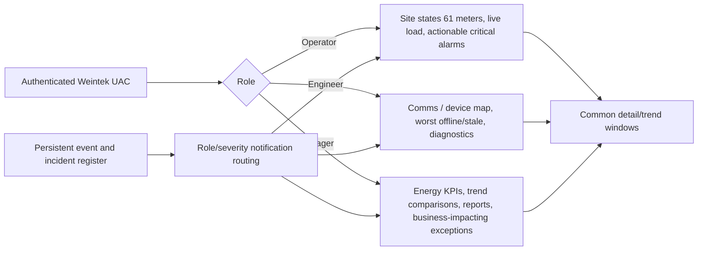
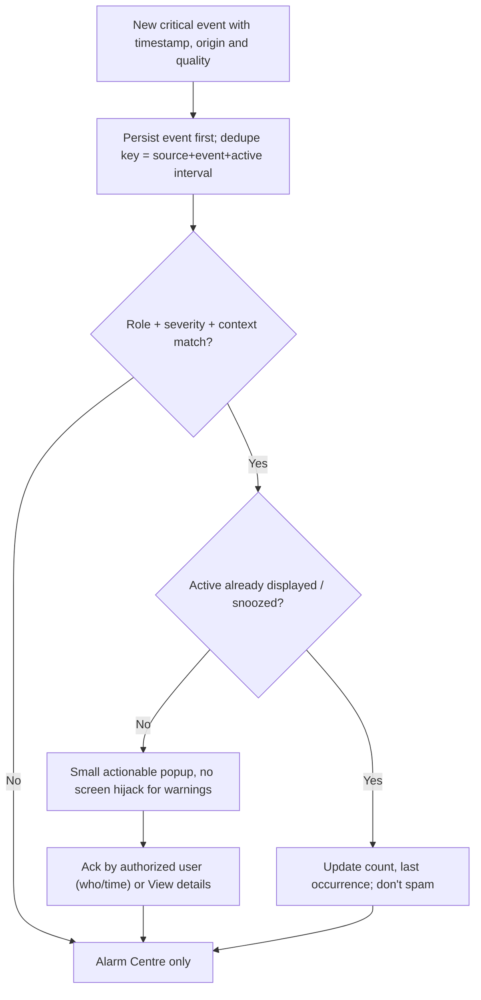

# UCS role-focused access and popup policy — primary site-authentic SLD

**Owner UI change (2026-10-13):** The prior three independent generic home designs are **REJECTED**. Production's first/main screen is **one real site-specific plant SLD** with role-specific authorized actions; preserved role/alert matrix below still applies as policy, not as approval of the old screen layouts. [Authoritative SLD design](PLANT_SLD_PRIMARY_SCREEN_CONTRACT.md). Actual source drawing pending.\n\n**Selected FHDX-220, 1920×1080 historical brief:** [SCREEN_DESIGN_BRIEF_FHDX220](SCREEN_DESIGN_BRIEF_FHDX220.md). **PLAN before EBPro** → [independent plan audit #38](https://github.com/raohassandev/Weintek-Macro-Javascript-based-reporting/issues/38). Native EBPro + supported JS Object only (not HTML). Resource Manager must show USB1, not SD; critical storage faults appear as role-routed notification, not daily management dashboards.
**Design status:** approved direction; not compiled EBPro windows. [Visual flow](VISUAL_PLAN.md) · [CC #1](https://github.com/raohassandev/Weintek-Macro-Javascript-based-reporting/issues/1).

## Principle
A screen must fully serve **its specific purpose**, without putting diagnostics/storage on every user's daily view. Reuse one common navigation shell, one Meter Detail template, one Trends template, one Reports template, and one Resource Manager. Only HOME landing experience differs.

## Window registry (proposed EBPro engineering IDs; not native fixed numbers)
| ID | EBPro screen | Roles | Purpose complete when |
|---|---|---|---|
| 100 | Login/Role Routing | All | authenticated user routed to permitted home; deny by default |
| 110 | Operator Home | Operator, Engineer, Manager if granted | 61 meters summarized, site load/generation, all active operational alarms, top exceptions, drilldown |
| 120 | Engineer Home | Engineer/Admin | comm success and drop counts, last good age, bad-quality meter ranking, Modbus fault types, maintenance queue |
| 130 | Management Home | Manager/Admin | daily/monthly kWh import/export/generation, cost/savings only if tariffs supplied, demand/quality KPIs, report preparation, exception banner |
| 210 | Reusable Meter Detail | Permitted users | selected meter’s max supported useful fields, source timestamps, quality, trend/report tabs; unsupported as N/A |
| 220 | Reusable Meter Trends | Permitted users | actual per-device persisted data, time range, gaps clearly shown |
| 310 | Historian / Reports | Manager/Engineer | date range, meter/device selection, summaries, export and record coverage |
| 410 | Communications & Meter Diagnostics | Engineer/Admin | all 61 acquisition health, connection configurations and traceable comm failure events |
| 510 | Resource & Storage Manager | Engineer/Admin; Manager read-only | CPU/RAM/storage health, recording truth, earliest/latest, forecast, verified backups |
| 610 | Commissioning | Engineer/Manufacturer with privileges | sanctioned settings, test connection, map registers, audit changes; no unsafe unrestricted write |
| 900 | Global Alert Popup + Alarm Centre | Role-filtered | concise reason, affected asset, impact, last known, acknowledgement and action navigation |

For unauthorized roles, block underlying actions/objects and any remote/Viewer route, not just hide navigation button.

## Role home compositions

## What is NOT on home
- Management: **not** CPU/RAM/USB gauges, backup buttons or detailed Modbus exception counters. Show only significant data-quality/backup exceptions that compromise report validity. Daily business KPIs and report date selector dominate.
- Operator: no admin restore controls, no raw register maps or large maintenance logs.
- Engineer: detailed resource stats available in Resource Manager, but not duplicated in daily diagnostic home without active fault.

## Event/state rules (configuration, not fixed Weintek registers)
| Event kind | Operator | Engineer | Manager | Always persist |
|---|---|---|---|---|
| Meter no response (single) | alarm badge if monitored circuit important | diagnostic alert | daily report exception, no popup unless material | Yes |
| Multiple critical meters offline | modal when operational visibility affected | modal when threshold reached | modal only if business reporting unreliable | Yes |
| Poll quality degraded, retries/exception | concise nonmodal | alert + diagnostics link | visible in quality KPI, no technical popup | Yes |
| USB disconnected / recorder write failure | modal if logging mandatory | modal with storage diagnostics | high-priority reporting-risk banner | Yes |
| Verified backup failed and due | log / summary | warning | management alert if reporting risk | Yes |
| Threshold exceed (voltage/power/frequency) | actionable alarm | diagnostic with source | summary incident if material | Yes |
| Scheduled backup successful | nothing | event log | nothing unless viewing reports | Yes |

## Popup state machine

This is conceptual policy: Weintek Event Log/Alarm Display/Action Trigger and UAC must be configured in actual EBPro version. True OS modal behaviors, alarm counts and persistent acknowledgement require target test. Deliberate reboot retention/duplicate handling tests required.

## Reuse and performance
- Share meter detail registers for all 61 devices; selection state per viewer (`PLW` / Private Index), independent historian (does not follow detail page).
- Keep manager page lightweight: update daily aggregates on a slower cadence; avoid firing many Macro/JS requests in every rendered object.
- Avoid duplicated real-time percentages and meters between cards. Dashboard summary should add context, not repeat every numeric value.
- Trend downsampling and limits must be measured; no claims about rendering 61 series simultaneously without hardware.
- Version all HMI tag/label data and role/notification rules in repo; site profiles control meter models and tag capabilities.
