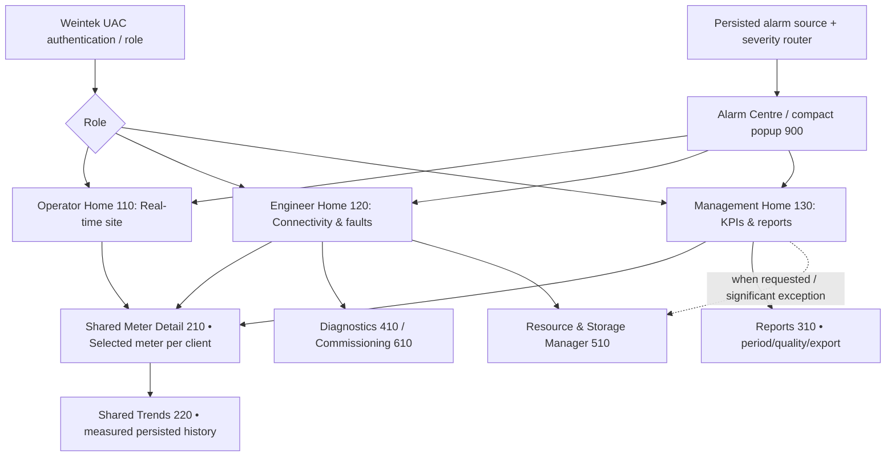
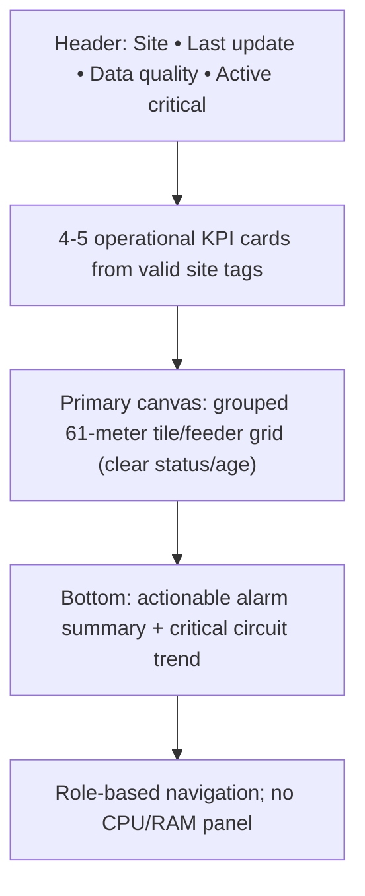
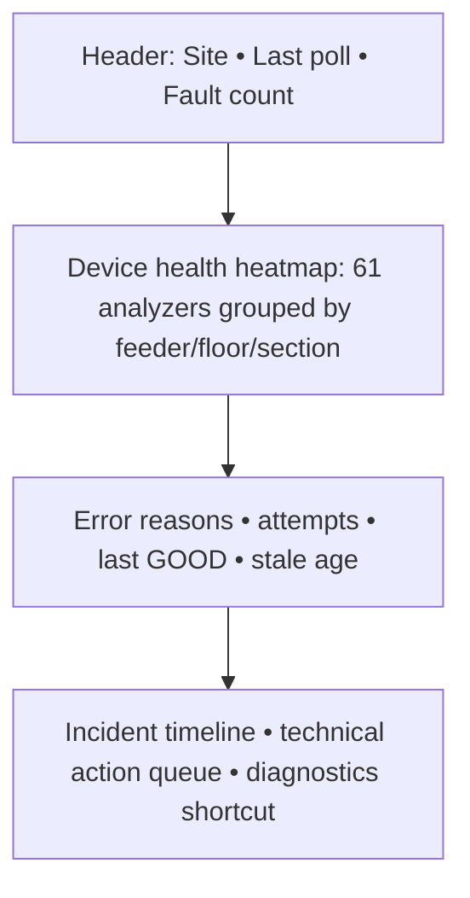
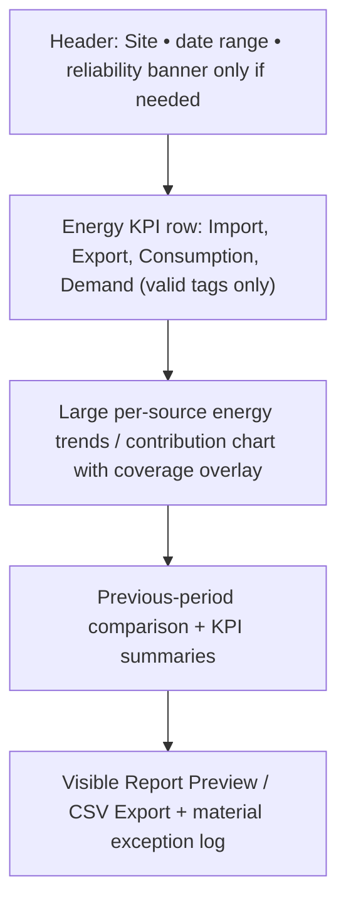

# UCS — cMT-FHDX-220 1920×1080 SCADA Screen Design Brief (Planning Freeze Candidate)
**Phase:** DESIGN SPECIFICATION ONLY; no compiled EasyBuilder Pro project and no physical HMI test.
**Approved primary hardware:** cMT-FHDX-220. **UI runtime:** native EasyBuilder Pro objects + model/OS-supported JS Object Canvas. **No PLC Web Browser on FHDX-220**, no arbitrary local HTML pages, no PC/IPC/server.
**Initial site:** 61 energy analyzers, configurable vendor/register maps. The purpose of each screen must be fully served; no unrelated infrastructure widgets on routine management/operational screens.

## 1. Visual design & technical constraints
| Topic | Frozen design rule | Proof / follow-up |
|---|---|---|
| Canvas | **1920×1080 design coordinate system** over HDMI; actual project resolution to be checked in EBPro | Model max HDMI 1920×1080; verify project/monitor scaling |
| Theme | Executive light: warm off-white `#F6F6F2`, card white `#FFFFFF`, forest `#244D3C`, text charcoal `#27332D`, neutral gray `#68756E`, subtle green `#EAF1E8`; no blue as primary | Customer management rejected blue theme |
| Incidents | Amber `#B57C2A` for attention and red `#B54F48` for urgent; text labels/icons always accompany color | Avoid alarm meaning carried by color alone |
| Type | Legible sans-serif supported by EBPro; main labels 22–28 px, large KPI 35–46 px, screen title 28–34 px, dense value rows never below legibility tested on display | Inspect actual distance and monitor |
| Layout | Header approx 88 px; sidebar 205–225 px on all role home windows; remaining grid responsive **within fixed EBPro 1080p coordinates** | Real EBPro positioning, not CSS responsive claims |
| Touch | Critical navigation/control targets recommended **≥44×44 px**, not tiny icon-only actions; support mouse/HDMI display | USB1 may be needed for touch input; verify port allocation |
| Data visualization | Native Numeric Display, Bit/Word Lamp, Bar Graph, Trend Display, History Data Display, Event Display, Alarm Display, Function Key; model-qualified JS Object Canvas for custom vector/shapes | Some mocked graphs are not native objects; source map explicitly notes type |
| UI state | Loading, Fresh, Stale, Offline, Unsupported (N/A), No History, Permission Denied, Storage Fault | Never display stale/unsupported as current 0 |
| Update | Live tags update by demonstrated poll/sampling cadence; charts/aggregates slower; do **not** issue a query or Flash write on each repaint | Actual CPU/RAM/61-device measurement |
| Consistency | No duplicated KPI/card and animated box value; a single source-of-truth per displayed metric | Audit duplicate data/human comprehension |
| Confidentiality | Management-only financial metrics require tariff source/effective date, with no speculative cost/savings | Site tariff and contract data are TBD |

## 2. Screen navigation: separate daily homes, shared functional windows

Window IDs are **project conventions**, not Weintek reserved window numbers; audit EBPro collisions before create. Do not copy 61 detail pages. A compact shared shell is reused but content is genuinely different per role.

## 3. Purpose-complete per-screen requirements
| Window | User goal | Required visible regions | NOT displayed routinely | Drilldowns/actions |
|---|---|---|---|---|
| **110 Operator Home** | See actual electrical/site state fast | site status and most critical alerts, 61-meter online/stale/offline grid with meaningful groups, current kW/kVA/PF/Hz summary where valid, missing meter count, active alarms with asset/time, large primary actions | Raw Modbus register list, CPU/RAM, backup buttons, financial forecasting | Select meter, acknowledge authorized alarm, trend, isolate affected section by filter |
| **120 Engineer Home** | Locate and diagnose failure without guessing blame | 61-device communications heatmap, last-good/attempt ages, timeouts/exceptions, failed poll summaries, incident log, site/driver configuration revision, worst assets and direct diagnostic navigation | Large cost/savings cards, unexplained magic healthy state | Select meter, check register map, connection test, controlled commission, Alarm/Resource screens |
| **130 Management Home** | Prepare trustworthy executive report | energy today/period totals and trends, import/export/production split **only if tags exist**, demand/quality KPI, reporting-period filter, comparison baseline, coverage percentage + exceptions, Report Preview/Export CTA | Always-visible USB/RAM/CPU gauges, device baud settings, routine backup logs | Report period, chart drilldown, list of material exceptions, optional Resource screen |
| **210 Reusable Meter Detail** | Maximum useful validated data for selected device | per-phase V L-N/L-L, A, total/per-phase kW/kvar/kVA, PF, Hz, kWh import/export, demand/peak, THD/unbalance/neutrals **if supported**, timestamp/quality/source, alarm/status, device/site group | Missing unsupported metrics shown as plausible zeros | Prev/Next meter, Trends, Diagnostics where authorized |
| **220 Meter Trends** | View retained truth for selected metric/time | persisted series with timestamp, gap marks, quality, Min/Max/Avg as supported, readable axes/units, date/day/week/month controls, exports if confirmed | Unbounded 61×full resolution graph refresh | date filter, channel selection, bounded zoom, report link |
| **310 Reports** | Produce accepted historical output on HMI | Site/Meter/Range, report template, generated time/units/source/coverage, quality/warnings, rows/summary, CSV export proof state | “PDF export” control before physical on-Weintek generation is verified | Query, Preview, Export CSV, retry and report errors |
| **410 Diagnostics** | Troubleshoot comms/historian distinct from source faults | network/subnet/Modbus logical device, last poll and error, protocol-specific exception, stale/disconnect intervals, recorder/media causes | No unqualified "meter guilty" or fake no-data zeros | Safe read-only probe, asset-specific diagnostics |
| **510 Resource Manager** | Occasionally assess hardware capacity, logging health and backup | FHDX-220 CPU/RAM/internal history + **USB1 only**, USB connected, recent write/read verify, actual recording heartbeat, earliest/latest, measured growth/forecast, export/restore audit (role gated) | **NO SD/microSD** panel; no unsupported USB SMART value | On-demand USB test, backup precheck, verified-history view, guarded restore |
| **610 Commissioning** | Manage preinstalled device profiles without EBPro wherever supported | setup wizard: site, device ID, driver, supported IP/slave/FC/map/scaling, test read, preview, explicit save/apply/rollback + audit | Arbitrary new communication driver installer, invisible control writes | Supported parameter changes only, manufacturer config boundary |
| **900 Alarm Centre** | Show incidents that require action | source/device/impact/onset, unresolved/acked, critical drilldown, filters by severity/role | Raw infrastructure telemetry without actionable meaning | Acknowledge/assign authorized scope; event persists independently |

## 4. Detailed 1920×1080 layouts (conceptual)
### Operator home

### Engineer home

### Management home

### Meter detail & Resource
- Detail top: Site > group > Meter 01..61 Prev/Next, state badge, last-good age; tabs Electrical/Quality/Energy/Trends/Device Info; one data template with indexed source and capability-aware sections.
- Resource: first band 3 independent **USB connected / File I/O proven / Recorder persisting** statuses, next bands CPU/RAM/history quota, USB1 free vs observed file growth and forecast, oldest/latest, safe backup; event ribbon lower. **SD card widget completely excluded**.
- Important: “same decorative page” is not a substitute for native editable HMI numbers; use empty PNG/graphics as backdrop and overlay live EBPro objects.

## 5. Native EBPro object feasibility mapping
| UI concept | Primary actual object | Alternative | Validation |
|---|---|---|---|
| KPI value | Numeric Display with tag + engineering unit | Native Text + JS Object Canvas for custom presentation | Confirm width/type/scale, float64 and quality handling |
| Good/stale/offline status | Bit Lamp / Word Lamp using quality code | JS Canvas badge | Change on timeout, no sticky success |
| Resource utilization | Bar Graph + Numeric Display | JS Canvas circle if SDK/CPU allows | Percent/probe freshness; no false donut on native Bar Graph |
| Live 61-meter grid | Native Picture + indexed Numeric/Lamp with fixed slots | JS Object Canvas if performance justified | Scope and refresh across all meters; page selection independent |
| Per-meter waveform/trend | Trend Display / History Data Display bound to supported actual Data Sampling | JS bounded graph based on proven on-HMI historical query | Live Private Index does NOT automatically retarget historical sampling source |
| Events/ack | Event/Alarm Display and UAC-gated objects | App status words with persistent historian evidence | Acknowledgment does not erase event |
| Navigation | Function Key / Action Trigger + PLW client selection | Supported JS Action with verified execution context | No global LW selected meter; Action Trigger Macro async caveat |
| Report/backup | SQL Query controls + supported Backup object, File export | Macro/JS bounded orchestrator | Local SQLite Advanced SQL/PDF not promised without test |
| Decorative background | PNG Picture (source SVG version-controlled) | EBPro shapes/static text | Model exact 1920×1080, no baked-in fake runtime values |
| HTML/CSS web page | **UNSUPPORTED on selected FHDX-220** | N/A; use Canvas/native | No PLC Web Browser portability from FHDX-820 |

## 6. Input/data and HMI asset package for eventual coding phase
Each screen must have a self-contained engineer handoff folder:
`designs/screens/<window-id>/preview.png`, `background-only.png` (1920×1080), `object-map.csv` (native EBPro object), `tag-contract.csv` (engineering source, **not native import file**), `interaction-flow.md` (events/roles), `state-table.md` (loading/stale/failure/empty), `tests.md` (EBPro/simulator/device acceptance). Reuse common style tokens and navigation assets from one source. Store licensed assets only; no font files.

**Existing Resource Manager SVG/PNG are 1600×900 concept assets**, NOT native 1920×1080 HMI engineering-ready backgrounds. Rescale/re-layout deliberately, preserve native object overlays and verify exact physical display geometry; do not simply stretch and claim final.

## Static 1080p handoff packs (generated offline only)
All four folders are created by [deterministic asset renderer](../tools/build_ucs_screen_packs.py) and validated by [offline checks](../tests/test_ucs_screen_packs.py). Each holds 1920×1080 **preview.png, background-only.png**, SVG sources, native EBPro object mapping CSV, engineering tag contract CSV (NOT an EBPro import-ready file), interaction-flow.md, state-table.md and tests.md. No customer live data is embedded. **Resource 510 is newly laid out at 1080p—not stretched from old 1600×900.**

- [Operator 110](../designs/screens/110-operator-home/preview.png) — complete real-time site view for 61 meters, only actionable incidents
- [Engineer 120](../designs/screens/120-engineer-home/preview.png) — communications/error investigation and maintenance
- [Management 130](../designs/screens/130-management-home/preview.png) — energy KPI, periods, historical coverage and report prep; **no infrastructure gauges**
- [Resource 510](../designs/screens/510-resource-manager/preview.png) — CPU/RAM, USB1, independent recording and backup proof, **no SD widget**

**Only native EBPro objects supply values.** The generated \`preview.png\` contains explicit "CONCEPT • NOT LIVE" labels and is NOT a real HMI capture. The \`background-only.png\` has no metric values, lamps, fake success or native object behavior baked in. Exact native object compatibility and versions remain untested pending GATE-2 device access.

## 7. Design audit and explicit no-go conditions
- Review **every** screen against its “purpose complete” table above, no duplicate metrics or pointless boxes.
- Confirm FHDX-220 native supported objects and OS/EBPro version when the project becomes buildable, not based on later FHDX-820 feature alone.
- Test independent Viewer UAC/client-private index selection; do not assume SDK/PLW semantics without real hardware.
- No extra-PC runtime, SD slot/PLC Web Browser, unsupported direct SQLite JS, mocked success, or unverified PDF button in any final screen.
- Role access protects underlying action/records, not just hides a card.
- Count of meters shown, space reserved for each metric, layout hierarchy and large hit targets must be verified at 1920×1080.
- Approve this **screen brief and overall design baseline before any implementation work**. Independent audit happens after plan freeze, before EBPro build.
