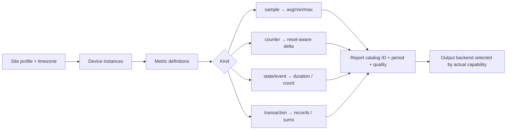

# Site Profile Guide — change configuration, not reporting software
[Visual plan](VISUAL_PLAN.md) · [JSON Schema](../schemas/site-profile.schema.json) · [Report catalog](REPORT_CATALOG.md)

## What changes between customer sites?
| Variable | Solar/Grid/DG | Factory/HVAC | UPS |
|---|---|---|---|
| Data source | Modbus meter/inverter | PLC tags/machine counters | Modbus UPS |
| Metric examples | kW, kWh, Hz, generator RUN | temperature, production total, line RUN | battery mode, load %, alarms |
| Semantics | sample + counter | sample + counter + state | sample + state + event |
| Periods | day, month, year | shift, day, month | day, month, custom |
| Reports | RPT-01/RPT-05/RPT-07 | RPT-03/RPT-10/RPT-13 | RPT-11/RPT-18 |
| Output | HMI/CSV/optional PDF | HMI/CSV | HMI/CSV/PDF |

## Proposed configuration hierarchy

## Schema contracts
- `site_id` unique site key; `timezone` IANA identifier.
- `collection.default_interval_seconds` required, but a metric may override it.
- `devices` include protocol, a non-secret endpoint alias, and `metrics` tied to site tags.
- Every metric declares `kind`: `sample`, `counter`, `state`, `event`, `transaction`; correct aggregation is not inferred from unit alone.
- `reports` use stable IDs from [REPORT_CATALOG](REPORT_CATALOG.md), reference metric IDs and request allowable output and reporting periods.
- `storage.mode`: `weintek_native`, `hmi_local_sql_query` (no external service allowed) describes intended implementation route, **not** a guarantee the target HMI supports it.
- `availability` is `planned` by default; promote to device/customer accepted only with evidence.

## Example files (fictional, not actual customer data)
1. [Solar + Grid](../examples/site-profiles/solar-grid-dg.json) — import/generation kWh and live kW.
2. [Factory + HVAC](../examples/site-profiles/factory-hvac.json) — running state, production count, temperature.
3. [UPS monitoring](../examples/site-profiles/ups-monitoring.json) — load %, on-battery time, alarms.

To onboard a site, clone an example, change site/device IDs, source tag identifiers, units/time zone/report IDs and routing based on an approved equipment survey. Do **not** commit real IPs, credentials or customer-sensitive history to this **public** repo. Device Modbus register maps belong to versioned site connectors/drivers, not generic report calculations.

## Validation rules to automate
- JSON Schema syntax and required keys.
- Unique device IDs, metric IDs and report IDs per site.
- Each report metric reference must resolve to exactly one declared metric.
- `sample` should use `avg_min_max` or `raw_only`; `counter` uses `delta_reset_aware`; `state` uses `duration_from_transitions`; `event` uses `event_count`; `transaction` uses `transaction_sum`.
- `pdf`/`xlsx` output on `weintek_native` requires a verified on-device renderer; currently must be rejected; requested output must exist in `storage.preferred_export`.
- `availability` for an example remains `planned` despite passing a JSON validator; validation is not physical proof.

**Hard engineering boundary:** This schema is OUR portable application configuration, **not** an EBPro native CSV/JSON project import format. A separate adapter is needed to configure EasyBuilder Pro, SQL Query within the Weintek native runtime. Full write-access/SQL query APIs must not be presumed.

## 2026-10-13 runtime policy
**Weintek-only**: no external-service mode. Site profiles may request native sampling or an HMI-local SQL Query path (capability still to be tested). XLSX and styled PDF cannot be enabled until proven on the exact on-device firmware. Historical designs using external collector/PC are superseded.
