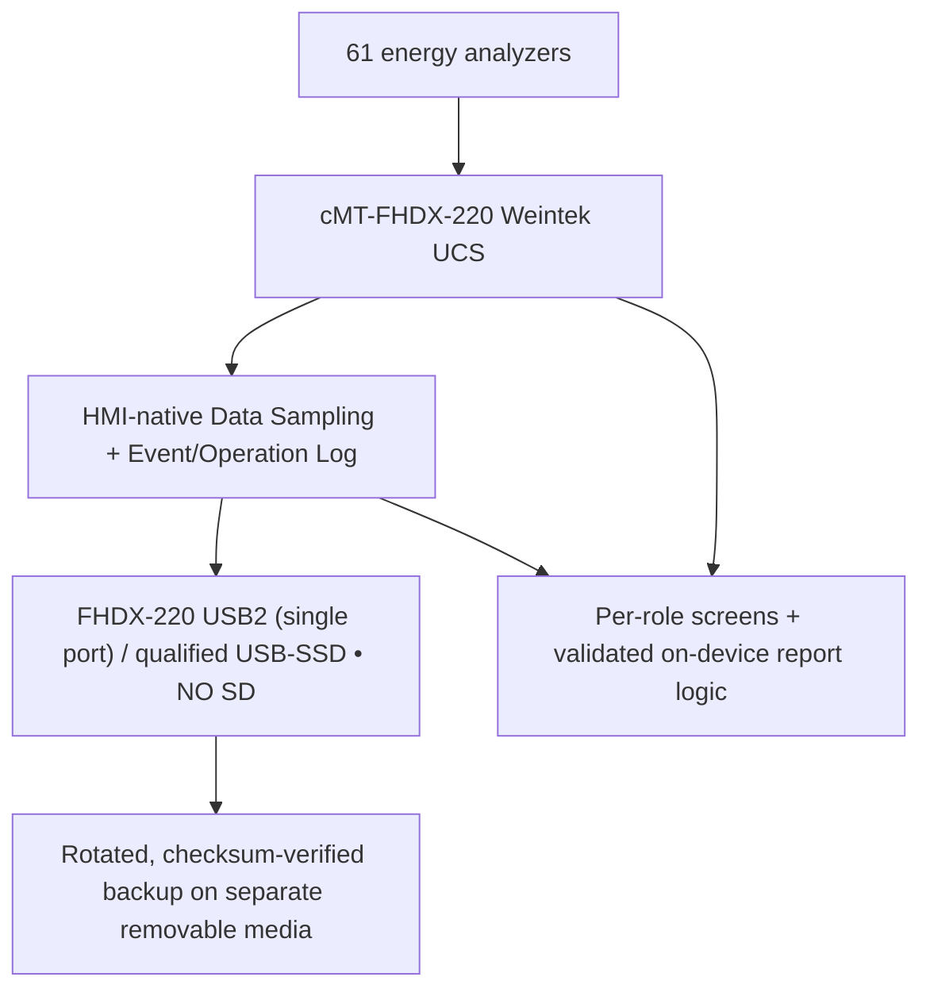

# Weintek-only UCS storage and backup decision — 61 analyzers
**Current direction:** owner-selected **cMT-FHDX-220**, **one USB2 host and NO SD/microSD**; no PC/IPC/server. [Hardware details](HARDWARE_TARGET_FHDX_220.md). This supersedes any prior IPC historian architecture described in older design commits. [Visual](VISUAL_PLAN.md) · [Resource Manager](RESOURCE_STORAGE_MANAGER_SCREEN.md) · [HTML R&D](../research/WEINTEK_HTML_FEASIBILITY.md).

## Single-USB critical failure/backup decision
**Read [FHDX-220 USB-only backup risk](FHDX220_SINGLE_USB_STORAGE_RISK.md) before selecting storage.** cMT-FHDX-220 has one USB2 host. The design cannot assume USB live historian + hot-swap second USB backup without a verified internal buffer/replay: **if the primary USB is removed, records can be lost**. Candidate A (native internal history → bounded verified USB archive) is the **first bench evaluation**, NOT an approved 61-meter durable solution; Flash write endurance/history quota must be measured. Any USB hub for touch+SSD also requires exact model/OS manufacturer qualification. If no safe independent backup method passes, historian reliability remains BLOCKED.

## Approved physical setup (pending actual Weintek hardware proof)

An independent removable archive does not execute software. An **industrial SSD in an untested USB enclosure is not a guaranteed Weintek feature**; qualify filesystem, power, detection, write/read, removal/recovery, and flash endurance. No internal SATA/NVMe slot is claimed.

## Source facts and constraints
- **Selected FHDX-220 official datasheet:** 1×USB2 host, SD card N/A, 4GB flash, 1GB RAM. Unlike FHDX-820, there is no SD slot. USB storage may contend with USB touchscreen/mouse and offline backup; any hub must be physically/vendor qualified.
- Manufacturer support generally recommends FAT32; ~4GiB maximum single file; design bounded rotation and never single unlimited SQLite journal.
- Verify mounted, writable **and** last persisted sample timestamp advancing. Presence = `LB-12048` is insufficient.
- Track `MEDIA_ABSENT`, `MEDIA_READONLY`, `WRITE_FAILED`, `LOW_SPACE`, `BACKUP_FAILED`, `RECOVERED`; record exact start/end plus per-meter gaps separately.
- Guarantee of *no missing records* cannot be made when meter/network/recorder lacks power. Always record missing intervals and measured data coverage.

## Capacity model (not imaginary GB estimates)
- Live 61-meter logging must be tested at chosen interval on selected cMT-FHDX-220 with real EBPro software.
- `daily_growth_bytes`: measured rolling growth of log files + event logs + indices/metadata; compare short-term and rolling-week median.
- `usable_free_bytes`: detected media free minus reserved headroom, pending file rotations and backup staging.
- Estimate remaining days from **measured positive growth** only. If no growth data or auto-purge/rotation is active, show retention policy and observed free-space margin; do not fabricate a fixed 218/245-day forecast.
- Report first/last **actually persisted** records, count of valid/bad/missing expected samples, and periods of lost communication; do not interpret date span as 100% capture.

## Backup / restore
Native `Backup (Global)` / `Backup (Trigger-based)` and media support are *candidate Weintek methods*; backup verification needs actual created files, per-file checksum/integrity check and restoration rehearsal. USB SSD is not an independent backup if primary and copy remain on same disk. Use a second periodically swapped removable medium or alternative manufacturer-supported **non-computer** backup destination only after proof.

Restore must be Admin-only with preflight, backup of current data and documented acknowledgement. Do not present restore on Manager daily home. Critical storage/recorder failures alert Engineer and, if report coverage at risk, Manager; routine media usage lives on Resource Manager.

## Acceptance gate
1. Qualified external media + mount/write/read/last durable record verification.
2. 61-meter logging independent of viewer selection at agreed sample period.
3. USB removed/reattached/full, abnormal shutdown, write errors and clock change tests.
4. Retention/capacity graph matches measured data, correct quality coverage, backup file recovery verified.
5. Management receives business exception notification; no constant infrastructure clutter.

## References
[Official cMT-SVRX](https://www.weintek.com/Product/Model/cMT-SVRX-822) · [cMT-FHDX](https://www.weintek.com/Product/Model/cMT-FHDX-820) · [Weintek System Registers](https://dl.weintek.com/public/EBPro/UserManual/eng/UserManual_separate_chapter/Chapter-22-System-Registers-UserManual-eng.pdf) · [Weintek Product Security manual](https://dl.weintek.com/public/Document/UM0/Product-Security-User-Manual-eng.pdf)
