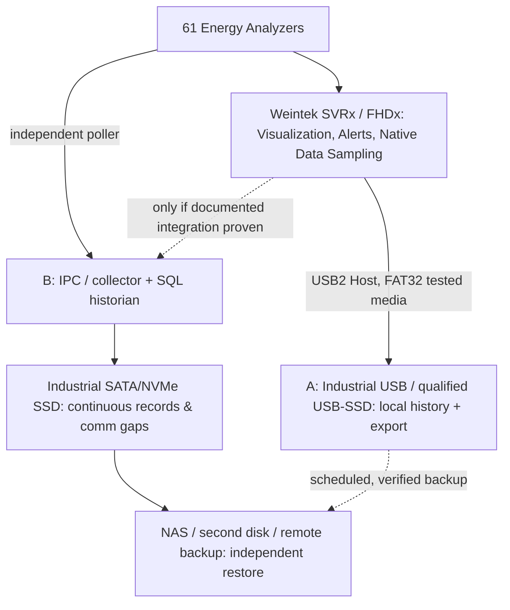
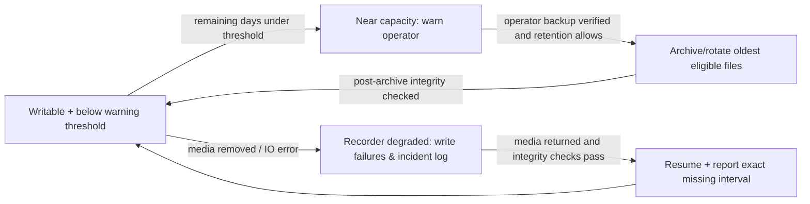

# UCS — 61 meter storage architecture, compatibility, and capacity policy
**Architecture proposal**, not a FAT32 USB-SSD device qualification. Decision pending exact cMT-SVRX/FHDX target and user requirement. [CC #1](https://github.com/raohassandev/Weintek-Macro-Javascript-based-reporting/issues/1), [storage issue #18](https://github.com/raohassandev/Weintek-Macro-Javascript-based-reporting/issues/18), [resource screen #19](https://github.com/raohassandev/Weintek-Macro-Javascript-based-reporting/issues/19).

## Hardware facts versus feasibility assumptions
- cMT-SVRX-822 and cMT-FHDX-820: **4 GB built-in Flash, 1 GB RAM, 1 × USB 2.0 Host, 1 × microSD** per Weintek product specs. Neither model's specifications list an internal SATA/NVMe SSD bay.
- Manufacturer field support: USB/SD should use **FAT32**; NTFS and exFAT are not the standard supported writable media format. FAT32 has per-file ~4 GiB limit, so rotate files rather than create one massive historian database.
- A USB-connected SSD inside a USB Mass Storage enclosure **might work** when appropriately powered and FAT32-formatted. **Vendor approval, controller compatibility, bus power, reattachment, USB mass storage behavior, and write recovery are not yet proven** on this project. Avoid recommending a specific SSD enclosure without test.
- Both units have a **single** USB host connector: connecting a USB SSD continuously reduces availability for other USB peripherals or removable backup. A powered hub is not a guaranteed supported workaround; verify separately.
- Weintek Product Security guide recommends external USB/SD or database synchronization for backups; also advises preparing for flash/USB/SD wear and enabling checksums where supported.
- **No system-tag can report SSD wear or SMART health through the HMI USB host by default**; if an external IPC/collector owns SSD, those disk SMART/temperature/health statistics must come from its monitored OS/service.

## Three legitimate topologies

**Preferred for demanding 61-meter, years-of-history, SQL reporting: B, while retaining HMI-local optional buffer/export for resilience.** For a limited retention HMI-only PoC, begin with **A using FAT32 industrial-grade USB**; test USB SSD as a separate media compatibility option, not a promised feature. The exact bill of materials follows measured sample rate and report retention requirement.

## Loss/gap semantics and auditability
- Every meter has stable `device_id`, independent polling, `last_attempt_at`, `last_good_at`, `quality`, `source_timestamp`, `stored_at`, and a reason code.
- Persist **missing-data intervals** and communication attempts as distinct events; never manufacture zero kW when a meter is offline.
- Separate `COLLECTOR_OFFLINE`, `METER_NO_RESPONSE`, `MODBUS_EXCEPTION`, `USB_REMOVED`, `STORAGE_WRITE_FAILURE`, `LOW_DISK`, `CORRUPT_FILE`, `BACKUP_VERIFY_FAILED`, and `RECOVERED`.
- HMI screen selection has no influence on how many meters are logged. No system can guarantee samples while both the meter and recorder are powerless; use UPS, bounded buffering and data-quality/coverage reports to give truthful evidence.
- Record *two clocks*: device sample timestamp (if available) and historian receive/write times; clock sync and time zone require explicit policy.

## Capacity / retention calculations (not HMI system tags)
**Do not invent capacity.** On commissioning take an actual min 3–7 day dataset with known sample rate and compression/storage layout. Record:
- `usable_free_bytes`: current storage available minus emergency reserved margin and active filesystem needs. HMI USB free: `LW-9076` (KBytes, UINT32); external IPC free via separate agent/API.
- `daily_growth_bytes`: robust rolling median of *actual persisted* daily file/database size growth, including SQLite WAL, indices, metadata, event logs and alarms.
- `days_until_full = floor(max(0, usable_free_bytes) / max(daily_growth_bytes, 1))` (only display when growth sample is adequate and > 0).
- `estimated_history_days = date(latest_stored) - date(earliest_stored)` vs `data_coverage = good_observed / expected` measured over the same interval. Oldest/last timestamp are **application database queries**, not Weintek system registers.
- `bytes_per_meter_per_day` and monthly rollups derived from storage samples; forecast include retention pruning, backup staging space, WAL and safety margin, not a fixed compression assumption.
- If retention auto-purge is enabled, "full in X days" is often misleading; display **retention target, expected reclaimed space, free-space runway and next cleanup separately**.

### Retention state machine

## Backup / restore safety
1. Create consistent snapshot / export, independent destination preferred. For SQLite host DB use proper online-backup API or safe checkpoint, not an unsafe blind copy of a live DB.
2. Compute checksum and verify it after copying. Record `last_verified_backup_at`, backup file range, location, bytes and success/failure.
3. An action to **Restore** is always admin-gated, confirms scope, stops writers/quiesces dependent readers, and creates a rollback snapshot. Avoid one-click destructive restore from GUI.
4. Device-safe flush/shutdown must use the documented HMI mechanism (Weintek security manual mentions `LB-9034` before shutdown), but does not substitute for UPS+backup.
5. Independent periodic NAS/off-device copies, retention and recovery drills; an SSD is **not itself a backup**.

## Commissioning selection criteria (simple)
- 2-meter test initially: local FAT32 USB read/write + disconnect, power cut recovery and file integrity; query earliest/latest sample.
- Expand to 61 and realistic polling/retention: measure actual bytes/day and I/O latency, not estimated 4GB/32GB marketing claims.
- Decide HMI-only vs IPC SSD based on read/write stability, retention need, report complexity and recovery evidence.
- No speed/storage “PASS” until actual device, firmware, storage model/enclosure, filesystem, run ID and observed logs are saved.

## Primary sources
- [cMT-SVRX-822 Weintek specs](https://www.weintek.com/Product/Model/cMT-SVRX-822)
- [cMT-FHDX-820 Weintek specs](https://www.weintek.com/Product/Model/cMT-FHDX-820)
- [WeintekUSA FAT32 media compatibility](https://forum.weintekusa.com/t/usb-project-download-upload-dos-and-donts/1848)
- [Weintek Product Security guide: history backup and checksums](https://dl.weintek.com/public/Document/UM0/Product-Security-User-Manual-eng.pdf)
- [EasyBuilder Pro system registers chapter](https://dl.weintek.com/public/EBPro/UserManual/eng/UserManual_separate_chapter/Chapter-22-System-Registers-UserManual-eng.pdf)
