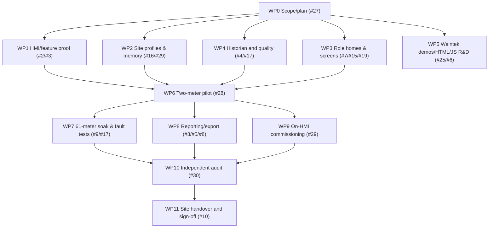

# UCS v1.0 — Parallel Engineering Work Packages & Deliverables
**Master:** [UCS final plan](UCS_FINAL_MASTER_PLAN.md) · [Acceptance matrix](UCS_REQUIREMENTS_TRACEABILITY.md) · [CC #1](https://github.com/raohassandev/Weintek-Macro-Javascript-based-reporting/issues/1)  
**Rule:** run genuinely independent research/design/tests in parallel; only hardware-dependent proof waits. Work packages are issue ownership boundaries, **not invented 100% progress bars**.

## Work-graph

## WP0 — Governance, R&D, formal baseline (Issue #27; independent)
**Inputs:** entire historical chat context, manufacturer docs, current GitHub #1–#25, owner corrections.  
**Outputs:** Master plan, requirement matrix, audit protocol, agent handoff, owner visual, strict no-PC site-schema contract; self-consistent decision log with superseded old suggestions flagged.  
**Acceptance:** exact-HEAD CI validates docs/schema; all links and requirements, no unsupported absolute feature claims, and a reviewer can navigate one entrypoint to tasks. **This milestone delivers PLANNING only**.

## WP1 — Device compatibility / vendor-specific confirmation (#2, #3, #25)
**Inputs:** target cMT-SVRX/FHDX exact model, hardware revision, OS build, EBPro release, manufacturer library & demos.  
**Outputs:** model-feature matrix with manufacturer URLs, SQL Query local SQLite limits, JS Object/Action runtime location, Multi-Viewer support, Private Index semantics, UAC, Data Sampling/historian limits, USB/SD/SSD storage compatibility.  
**Acceptance:** documented evidence grades; actual hardware-supported feature bench for desired functions. Missing target label → **[BLOCKED: exact-model]**, continue doc/fixture work.  
**Owner question when required:** photo of HMI back label + installed EBPro/OS text; no long test form.

## WP2 — Normalized data model & memory boundary (#16, #11, #29)
**Inputs:** [proposed memory map](../contracts/meter-memory-map.json), field catalog, schema, device map.  
**Outputs:** 61×128 word validated shared live cache, typed quality/timestamps, per-client indexed selection, app register reservations, system tag dictionary and exact EBPro-export-matched import CSV.  
**Acceptance:** automated collisions/bounds/unit/type tests and real EBPro names/read-only system tag checks. Use official user/system LW and PLW address semantics, not guessed registers.
**File ownership:** `contracts/`, `tags/`, `scripts/validate_memory_contract.py`; coordinate shared tag CSV with pilot.

## WP3 — Visual design/UI implementation (#7, #15, #19)
**Inputs:** role storyboard, 1600×900 light executive Resource Manager SVG/PNG, official EBPro objects, JS SDK, UAC.  
**Outputs:** three separate home screen assets/projects and navigation; ONE common Meter Detail template, reusable Trends/Reports, Diagnostics, Commissioning and role-bound alert popup; native dynamic register objects + JS Canvas where qualified.  
**Acceptance:** screenshot and actual editable EBPro project version; “meter 1 vs meter 37” independent Viewer navigation; manager does not see permanent storage dashboard; alarm popup preserves logs. Synthetic visuals must carry **DEMO** labels until real data.
**File ownership:** `designs/`, `js/ui/`, `hmi/screens/`; coordinate EBPro project with pilot owner.

## WP4 — Historian sampling/storage truth (#4, #17, #18)
**Inputs:** manufacturer Data Sampling/Event Log docs, sample periods/retention, media and register mapping.  
**Outputs:** all-meter continuous sample/quality capture path, gap/incident ledger, explicit poll-failure reasons, sample timestamp/unit conventions, bounded file storage/rotation, correct USB-present vs write/read vs actual recorder proof, backup and restore evidence.  
**Acceptance:** two-meter failure/recovery and simultaneous live capture, not a single selected-device LW history; full 61 soak; no false zero or fabricated downtime cause.
**File ownership:** `hmi/history/`, `macros/history/`, `contracts/quality/`, POC evidence; no external collector allowed.

## WP5 — Manufacturer demos and special UI research (#25, #6)
**Inputs:** manufacturer DemoProject catalog, official product and EBPro/JS manuals.  
**Outputs:** list/sample sources with date/license/version; review cMT-FHDX-820, cMT-SVRX-820, JS Object×UAC, Data Log handling, Trend, Event Statistics, Index Function, SQL multiple results; safe sample extraction permitted by license.  
**Acceptance:** credible demo source mapping; HTML-from-USB feature marked actual device PASS/FAIL/BLOCKED; never claim HTML browser DOM exists within JS Object; cMT-FHDX-820 (W) distinguished from normal HMI.
**File ownership:** `research/`, `experiments/html-poc/`; no production dependence on unproven HTML.

## WP6 — Runnable 2-meter end-to-end HMI pilot (#28)
**Inputs:** WP1–WP4 interface/contracts and exact Weintek model.  
**Outputs:** **real EBPro project** (native project file/archive), 2 different meter profile configs, actual one-screen detail, native Trend/History source independent of page, alarm event path, USB storage probe, on-HMI CSV export, device-specific installation and rollback instructions.  
**Acceptance:** artifacts in GitHub safely licensed, reproducible compile/simulator/physical logs; named meters and verified file; managed by release branch PR, not screenshots alone.  
**Critical gate:** first validated proof before 61-meter production claim.

## WP7 — 61-meter full-scale commissioning/soak (#17, #9)
**Inputs:** accepted 2-meter pilot, physically configured 61 endpoints, chosen sampling interval, approved retention.  
**Outputs:** 61 devices poll status, data age, error counter/event log and record coverage; two/three concurrent viewer screens; measured memory/CPU/USB growth; 24h+ soak length approved by site.  
**Acceptance:** actual throughput/availability and exported reconciliation; missing meter/cable/power/network/storage outage distinction with confidence; no claim zero data loss under total power loss.
**P0 performance thresholds:** numerical max poll age, CPU ceilings, storage growth and acceptable response time must be **derived from physical baseline and approved by owner/customer before final PASS**; don't invent 1s/5s thresholds.

## WP8 — On-HMI reports and export (#3–#8)
**Inputs:** verified native historian and SQL/query capabilities, 22 planned templates, user approved reporting periods.  
**Outputs:** date filters & bounded pages; daily/monthly energy, demand, quality, communication downtime/coverage; no-data indicator; CSV file and selected management-ready summary; optional extra formats only if native Weintek generation verified.  
**Acceptance:** raw vs report reconciliation and repeatable negative tests. If custom PDF unavailable: clearly mark **UNSUPPORTED** with decision, not fake “we can generate it on PC”.
**Quality bar:** no sum(kW) energy, no interpolating missing values without explicit policy.

## WP9 — On-HMI role-secure site commissioning (#29)
**Inputs:** target EBPro project and allowed driver profiles; actual brand/register map from equipment docs.  
**Outputs:** Engineer setup wizard, device slots, Modbus connection proof, tag map preview, test read, save/apply/rollback and audit trail; Manufacturer protected schema/driver release operations; no runtime addition of unknown drivers without real support.
**Acceptance:** two different meter brands configured without duplicating screens or editing generic logic; unsupported profile rejected without destabilizing normal acquisition.

## WP10 — Independent audit & fix loop (#30)
**Inputs:** exact SHA, full program/project and test evidence.  
**Outputs:** [22 audit gates](INDEPENDENT_AUDIT_PROTOCOL.md), [36 requirements](UCS_REQUIREMENTS_TRACEABILITY.md), security/stability assessment, verified P0 failures and issue assignments.  
**Acceptance:** no open critical/high failures; independently reviewed exact head. Design-only approval NEVER equals release approval.

## WP11 — Delivery/field release (#10)
**Inputs:** audited HMI project, export/backups, role training materials and commissioning records.  
**Outputs:** signed site-specific installation package, versioned rollback firmware/project, physical cable/USB/media inventory, administrator recovery procedure, operator/engineer/management one-page guides, report samples and accepted incident response.  
**Acceptance:** customer sign-off plus verified evidence uploaded to GitHub or privacy-safe references. Mark 100% only after all release gates.

## Agent allocation & collision-safe claims
- Worker IDs unique: `W-<4-char>`. Claim scoped task `[INPROGRESS @W-xxxx since <UTC>]`, reread live issue, stay in file ownership boundaries. If another worker owns it, choose different AVAILABLE task.
- Parallel research and code tests are encouraged; **one engineer owns the EBPro project binary/central tag registry at a time**. Other agents can prepare JSON schemas, diagrams, drivers and test fixtures; integrate through scoped PRs.
- “Claude audit” or any named reviewer must be **real recorded independent evidence**. If no reviewer available, leave [REVIEW] and don't describe audit as PASS.
- Owner interactions are brief: a visual preview and one essential decision, not raw logs/manual pages.
- Current exact issue references are the live GitHub issues above; issue number and status supersede stale copied percentage.
