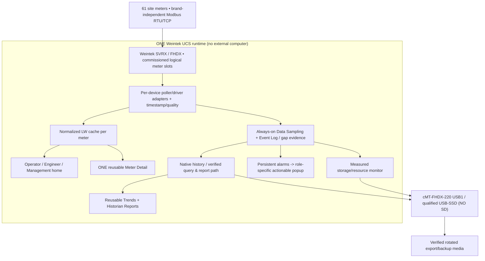

# UCS BASELINE v1.0 — Final Engineering Master Plan
**Project:** Universal Control & Supervisory System (UCS), Weintek Macro/JavaScript-based Reporting  
**Status:** **DESIGN/EXECUTION BASELINE APPROVED DIRECTION — NOT DEPLOYED / NOT DEVICE-ACCEPTED**  
**Baseline date:** 2026-10-13 (PKT)  
**Authority:** [Command Centre #1](https://github.com/raohassandev/Weintek-Macro-Javascript-based-reporting/issues/1); this document overrides **older conflicting architectural suggestions**.  
**Purpose:** engineer can implement; independent AI auditor can audit; new chat can resume without owner retelling history.

## Active hardware target — owner selection (2026-10-13)
**Weintek cMT-FHDX-220** is the active UCS build target, *not* FHDX-820 or SVRX. [Model-specific engineering contract](HARDWARE_TARGET_FHDX_220.md) / [JSON](../contracts/hardware-target.json). Manufacturer datasheet: 4 GB Flash, 1 GB RAM, one USB2 host, **NO SD/microSD**, HDMI max 1920×1080, minimum EBPro V6.04.02. Manufacturer EBPro V6.10.01 matrix: JS Object and SQL Query Y; **PLC Web Browser is FHDX-820 ONLY, not 220**. Exact firmware, installed EBPro, local SQLite advanced custom SQL and 61-meter capacity remain unverified.

## Planning phase authorization (2026-10-13)
**Owner's order:** Complete plan first, obtain **independent plan audit**, resolve findings, and obtain explicit owner approval **before** any EBPro/JS/Macro implementation. See [Plan Freeze](PLAN_FREEZE_PRE_IMPLEMENTATION_AUDIT.md), [Audit #38](https://github.com/raohassandev/Weintek-Macro-Javascript-based-reporting/issues/38), [1920×1080 Screen Brief](SCREEN_DESIGN_BRIEF_FHDX220.md), [Single-USB P0 Risk](FHDX220_SINGLE_USB_STORAGE_RISK.md) and [restored meter/memory contracts](DYNAMIC_SCREEN_ARCHITECTURE.md). Older green but unmerged [PR #35](https://github.com/raohassandev/Weintek-Macro-Javascript-based-reporting/pull/35) findings and offline golden fixtures are integrated without reverting [FHDX-220 PR #36](https://github.com/raohassandev/Weintek-Macro-Javascript-based-reporting/pull/36). These are planning artifacts, NOT device proofs.

## 0. Executive contract and evidence policy
Build a **reusable site-configurable, SCADA-grade visualisation, diagnostics and historical reporting system**. Start at **one site with 61 energy analyzers**; subsequent sites may use different meter brands, combinations, quantity and profiles. Build one reusable engine/driver mapping and shared screens, not 61 screen copies. Operators see live plant state; engineers see actionable diagnostics/commissioning; management sees defensible energy reports and exceptions.

**Hard boundary:** all acquisition, historian, reporting, HMI screens, JS/Macro calculations, alarms and export generation run **only on Weintek cMT-SVRX/cMT-FHDX-compatible HMI hardware**. Attached USB, microSD and device-qualified USB-SSD count as storage, not an external computer. **Never introduce PC, IPC, Raspberry Pi, NAS-based report processor, remote SQL server, Node.js process or cloud reporting engine** as a workaround. An existing user's cMT Viewer/management client can view the HMI if product-supported; it must not be required to host runtime, run server code or complete historical reports. If a demanded report cannot be proven on-device: **BLOCKED/UNSUPPORTED**, not a secret external workaround.

**Evidence levels:** PLANNED → CODED/OFFLINE-TESTED → EBPRO-SIMULATOR-PASS → NAMED WEINTEK DEVICE-PASS → CUSTOMER-ACCEPTED. A design, demo drawing, generated PNG, running GitHub Actions test, downloaded manufacturer example or passing fake-data query is *not* device evidence.

## 1. One-page system flow

**No browse-to-meter = start logger behaviour.** Logging all commissioned meters must continue without a connected viewer, even while a different meter is selected, and across native screen changes.

## 2. What this project evolved from — complete historical conversation
1. Customer initially demanded meaningful **historical reports**, not simple log files. Early questions were whether cMT1102/cMT1106X or advanced cMT models could run SQLite directly from Macro/JS.
2. Weintek manufacturer docs identify cMT1106X as Basic, unsuitable for the desired SQL Query/JS approach; `cMT1102` exact label has not been verified. cMT3102X and higher Advanced models were feasibility candidates, but **current target is cMT-FHDX-220**. Actual OS/firmware and installed EBPro project/version remain unknown.
3. SQL Query object (some models) can access supported SQLite files on USB/SD. **No confirmed generic `sqlite.open()` in Macro/JS**; arbitrary SQL Advanced Mode against Local SQLite and direct native datalog tables are separate **unresolved tests**. `RecipeQuery()` isn't a generic historian API.
4. Requirement expanded to universal 22-template historical reporting, indexed manufacturer R&D, fully traceable GitHub execution and a one-page pictorial owner view.
5. Owner requested **61 energy analyzers on a real site**, Web-SCADA-quality modern screen designs, operator/engineer/manager roles, maximum useful per-meter variables, trends, charts, maintenance and international-management reporting. Device types vary from site to site; commissioning should take place **as far as technically possible through HMI settings screens**, with minimum EBPro editing.
6. Owner proposed one identical meter screen, per-client selection and Macro/JS address switching. Design agrees, using **client-private selection (PLW/private index)** and shared normalized LW blocks, with genuine simultaneous-client test required.
7. Owner required missing-data, meter-offline and communication-break **periods to be recorded and explain why a report has gaps**. Never equate zero reading with no reading or state unequivocally which hardware is guilty without independent evidence.
8. Owner requested graphical CPU/RAM/storage, connected versus working versus recording proof, earliest/latest history, retention forecast, backup/restore administration. Dedicated Resource Manager, not always on management home; actionable failures use the alarm route.
9. First management mockup had a **blue/dark theme**, rejected by real management. Approved UI direction: **light executive, warm off-white/neutral/muted green, discreet amber/red incident highlighting**. Repo now holds editable SVG, background-only PNG, system-tag dictionary, object map, proposed JS USB probe and Macro source; these are not a compiled EBPro project.
10. Owner reviewed the actual GitHub Mermaid diagram and explicitly **rejected its PC/IPC reporting branch**. On 2026-10-13 architecture rewritten to Weintek only; all older external-computer fallbacks superseded.
11. Owner requested separate purposeful home screens for Operator, Engineer and Management, only role/action-worthy popups, historical event logging, and official [Weintek Demo Projects](https://www.weintek.com/Download/DemoProject) R&D.
12. Owner asked if HTML files from internal/USB media could render and update. Official JS Object is Canvas, not browser DOM; PLC Web Browser exists only on supported local-screen models and local `file://` is **unverified**; WebView/EasyWeb are remote HMI presentation, and FHDX-820 (W) Chromium HTML5 model is a **different browser-focused product**, not automatically an EBPro historian.
13. Owner explicitly asks AI to manage manuals/tests/links/GitHub; human should see a **clear visual and one necessary decision at a time**, not dozens of test instructions.

## 3. Hardware and sizing baseline
- Initial deployment: **1 site, 61 energy analyzers**. Their exact manufacturer/model/register maps, Modbus network topology, reading intervals, number of logged metrics and historian duration are **TBD site facts**, not invented.
- Target model: **Weintek cMT-FHDX-220** chosen by owner. Obtain actual OS/firmware/EBPro and on-device proof before function acceptance. Other model variants are not drop-in substitutes.
- No assumption that manufacturer Basic/Standard/Advanced and SVRX/FHDX all expose identical JS Object, SQL Query, system tags, browser or private-index behaviour.
- A 2-meter vertical slice must pass before load testing 61 physical/logical slots. Hardware limits on total Data Sampling objects/channels, tag connections, histories, polling/presentation load, simultaneous viewers and storage are measured not guessed.
- Site drivers must support scale factors, engineering units, function codes, register address base, byte/word order, signedness, live request timeout, retries, device health and supported optional features. **Do not invent register maps.**

## 4. Generic site configuration and runtime commissioning

- Define controlled versioned `Site → Device → DriverProfile → Metric → ReportTemplate → RolePolicy` schema. Three fictionally labeled sample profiles (solar/factory/UPS) already exist; the production site commissioning values must come from site survey, not fake examples.
- Engineer on-HMI wizard: select preinstalled driver type, site/device ID/label, Modbus TCP or RTU address/device settings as supported, list mapped tags, read-only test/preview, mapping validation, sample interval where supported, quality thresholds, alarm/report binding, Save/Verify/Rollback. Commissioning logs include who, when, before/after and result.
- Manufacturer/Admin gates schema, driver updates, reserved storage, dangerous write functions; Engineer can commission only authorized profile-level options. **New brand protocol, project device object, macro library or unsupported register driver may still require EBPro project update**. “100% runtime-configurable” is NOT promised.
- Source addresses, scaling and tag definition belong to driver-profile revisions, **not in reused screen buttons or generic UI code**.
- Use actual EBPro Address Tag Library export for native CSV schema; repo’s generic `tags/resource-manager-dictionary.csv` is *not* directly import-ready without that match.

## 5. Memory/register architecture
**Prior engineering proposal (not reserved in a live EBPro project):** 61 shared `LW` live cache blocks with base word 256 and stride 128 words. `LW-256..LW-8063` covers 61 × 128 = 7808 16-bit words. Float32 uses two words, large cumulative counters can use 4-word Float64 or defined UInt64. Optional unsupported data displays **N/A**, never 0. Exact normalized fields, gaps, types and offsets: [memory contract](WEINTEK_MEMORY_CONTRACT.md), [JSON](../contracts/meter-memory-map.json); remove collisions before commissioning.

- `LW`: server-side volatile normalized live words, timestamps and quality. Do not store durable history in LW, and do not overwrite reserved system area `LW >= 9000`.
- `LB`: system/global application flags; distinguish vendor system flags such as USB-present from application state, no blind allocation in `LB >= 9000`.
- `PLW`/`PLB`: client-private selected meter, current tab, filters and UI controls. Proposed `PLW-100` selected meter must be checked for collision with actual EBPro project/UAC. Manufacturer **Private Index 0 `PLW-9200`** offsets *indexed LW objects*, setting `(meter_id−1)×128`. No direct PLW object indexing. `LW-9200` is global Index 0, unsuitable for simultaneous independent viewers.
- `RW`/`RW_A`, `PRW` (where supported): infrequently changed, validated retentive settings only. Do not continuously write samples/rapid counters to retentive memory; protect endurance and restore/versioning.
- `RBI`/`RW_Bit`, `LW_Bit` only if documented; **do not invent a universal `RB` device**. For bit-indexed LW/LB, index semantics differ; verify object type.
- Project proposal currently uses app status registers `LW-8250..8253`, `LW-8270`. Reserve, review and consolidate them with all new allocation before build; there may be reserved UAC/SQL/Trend control words and vendor system tags.
- Official system tags for CPU, RAM, USB/free/history, clock, backup and alarms should be used **only when exact model/OS Address Tag Library supports them**. Status is read-only unless vendor documents control write explicitly. See Resource pack.
- Memory contract is **a candidate**, not a claim that all 61 data fields have been written to LW or that the HMI project has enough runtime capacity.

## 6. Visualization / navigation contract
**One reusable shared shell** + three role-specific landing pages, one shared Meter Detail, shared Trends, Reports, Engineer Diagnostics, Commissioning and occasional Resource Manager.
- Operator: realtime availability of all 61 meters, source/site load, priority electrical exceptions, quick filter/search/drilldown.
- Engineer: faulty/offline/stale/rate-limited meters, reason/duration, Modbus errors, test/commission controls, maintenance record and contact details if configured.
- Management: period KPIs, energy trends/variance, quality/coverage indicator, one-click report preview/export where supported; no full CPU/RAM charts on everyday home.
- Reusable Meter Detail: L-N/L-L voltages, currents, kW/kvar/kVA by phase and total, PF, Hz, import/export kWh, kvarh, demand/peak, neutral current, phase rotation, THD/harmonics, status/alarms and metadata **only when meter driver provides valid values**. Bounded numbers and charts, source units, last good timestamps, stale indicator, capability-driven layout.
- Cross-client selection uses separate client-private state; one viewer selecting Meter 37 cannot switch another viewer from Meter 1. UAC must authorize not only page but data/actions. Never assume JS in cMT Viewer necessarily executes on trusted HMI server.
- Management's **Resource Manager** is a deep screen with CPU, memory, internal historian quota, USB1 or qualified USB-attached SSD (NO SD), storage connected/write-read/actual persisted freshness, earliest/latest time, measured growth forecast, independent verified backup. Report-affecting failures show actionable alert to management.
- UI uses native EBPro Picture, Numeric Display, Bit/Word Lamp, Bar Graph, Trend Display, History Data Display, Event Display, Function Key and model-qualified JS Object Canvas; screen PNG only background. A concept donut is not automatically a native EBPro control. Use light executive visuals and accessible labels, no fake live values.
- Action severity routing and dedupe are in [ROLE_BASED_UX_PLAN](ROLE_BASED_UX_PLAN.md) + [policy JSON](../contracts/ucs-role-ux-policy.json). All critical/alarm events persisted **before** popups; popups never constitute the only durable record.

## 7. Historian and evidence of communications failures (hard safety requirement)
- Capture **all commissioned meters continuously**, regardless of active page. Never sample only the last viewed meter; do not use a client-selected LW register as the sole historic source.
- Each sample/attempt retains `site_id, meter_id, metric_id, value, engineering_unit, attempt_time, receive_time, persisted_time where known, quality, source_error_code`. If Weintek-native file format lacks these columns, prove a separate **on-Weintek** event/quality ledger method (e.g. reserved sampled channels + Event Log), or **mark capability blocked**. Do not fabricate SQL table access to the internal historian.
- Quality states separate `GOOD, STALE, COMM_TIMEOUT, MODBUS_EXCEPTION, DEVICE_NO_POWER_INFERRED, LOGGER_UNAVAILABLE, MEDIA_ABSENT, WRITE_FAILED, NOT_SUPPORTED, RECOVERED`; inferred diagnoses remain hypotheses unless independent electrical/protocol evidence exists.
- On failed read do not insert zero for power. Track last-good sample separately, show stale age, and log absence interval start/end and missed polls. Report date coverage = valid expected polls / scheduled expected polls **with known instrumented assumptions**; after HMI-wide outage, event continuity may not exist and must be labeled `UNOBSERVABLE_INTERVAL`, not simply “meter at fault.”
- Log reason, affected meter or recorder, first/last failed-attempt timestamps, attempt count, event state, recovery and whether storage was trustworthy. Communications downtime and storage downtime are separate incident dimensions.
- Energy (kWh) from counter deltas/reset/rollover or time integration (kW × elapsed_hours) with data gaps; never sum samples as kWh. Normalize import/export sign/direction. Ratios and PF use explicitly approved formulas.
- Native Data Sampling + Trend Display datasets often fixed to project objects; **Live Indexing does not automatically retarget historian dataset**. Two-meter actual persisted history and dynamic report query must be demonstrated separately. Record storage-write acknowledgement/error if available on version.

## 8. Report engine / customer deliverables
[22 report templates](REPORT_CATALOG.md) grouped as:
1. Raw history & trends;
2. daily, shift, monthly and yearly peak/avg/min/max with quality counts;
3. generation/load/import/export kWh, demand, phase/PF/power quality;
4. generator equipment uptime, fault/alarm/ack events;
5. production/batch/UPS/process and per-unit KPIs **only where configured tags exist**;
6. comparison periods, missing data and report completeness;
7. customer-formatted summaries with searchable device/date, stable paging and evidence of source/coverage.
Use on-device Macro/JS/SQL Query functionality only as verified; report requests must be bounded, read-only, versioned, authenticated and capable of showing `NO DATA / PARTIAL / FAILED`. **CSV/Excel-compatible CSV** is primary export candidate; custom XLSX, branded multi-page PDF and print creation are **UNPROVEN** until an on-Weintek method passes physical proof. Manufacturer `PDF Reader` is not PDF generation. Do not introduce any external report processor.
Report header includes site, device, interval/timezone, units, aggregation definition, first/last covered timestamps, overall coverage, file creator/revision and missing intervals. Filtering and date boundaries must be tested against clock/timezone anomalies.

## 9. Storage, backup, and Resource Manager
- **cMT-FHDX-220 has one USB 2.0 host and NO SD/microSD slot**; FAT32 compatibility and per-file limit constrain rotation. USB-attached SSD is conditional on exact enclosure/power/filesystem and real test. Do **not** claim internal SATA/NVMe or SMART access from HMI tags.
- Four **independent** storage states: `MEDIA_PRESENT` from USB system bit; `SPACE_AVAILABLE` from UINT32 free size/low-space bit; `WRITE_READ_VERIFIED` from scoped on-demand Local HMI JS probe where supported; `HISTORIAN_PERSISTING` from advancing *actual* stored history. Backup checksum/readback result tracked separately, with age/TTL to stop a latched good flag.
- Existing [resource engineer assets](../designs/resource-manager/README.md), [tags](../tags/resource-manager-dictionary.csv), [JS probe](../js/ucs_usb_write_read_probe.js), [Macro](../macros/UCS_STORAGE_STATUS.mcr) require EBPro compilation/physical testing. No file probe can guarantee resilience over sudden power loss or represent all 61 devices.
- Earliest/latest stored record and free-space runway based on measured data, not fake graphs. `days_remaining = usable_free_space / measured_bytes_per_day` only when supported by enough observations; include rotation policy, backup staging and reserve. Show `N/A—insufficient sample` otherwise.
- Backup requires a consistent snapshot or native backup mechanism, checksum/reconciliation, **physically separate removable media** if possible, tested restore/rollback, operator confirmation and UAC rights. A second copy on the same USB SSD is not independent.
- Storage full/removed, media reconnected, RTC moved, logger restarted, sampling stalled and USB errors must be tested with specific failure outputs and alarm roles.

## 10. Native HTML/JS UI technology decision
- **Mainline:** EasyBuilder Pro native object + JS Object Canvas widgets and Macro workflow: best chance of deterministic HMI-only implementation on eligible SVRX/FHDX.
- **Experimental:** PLC Web Browser is NOT supported on the selected FHDX-220 according to EBPro Appendix A (it lists FHDX-820 only); dynamic local `file:///usb/index.html` and register bindings unsupported until tested. A USB HTML file existing does **not** mean it can run embedded.
- EasyWeb/WebView are HMI access options, not general custom HTML hosting.
- The distinct cMT-FHDX-820 **(W)** is an HTML5/Chromium browser-focused device, not assumed to run the same native EBPro historian. Do not replace mainline architecture based on this name similarity.
- [HTML test input](../experiments/html-poc/index.html) tests styling/JS only, never a live UCS. [18 demo catalog entries](../research/demo-catalog.json) index official sample projects; no demos are claimed downloaded/imported/tested.
- HTML fallback must stay optional, off critical data capture path and have a well-documented disable switch.

## 11. Security and software conventions
- Versioned driver/meter/report schema, type-safe field definitions, predictable snake_case keys for data contracts, meaningful UPPER_CASE for state enums; no magic register addresses, hidden globals or hardcoded site devices in generic screens.
- Explicit request/state lifecycle: IDLE/PENDING/READY/ERROR/TIMED_OUT; request IDs prevent stale asynchronous response being displayed after meter selection changed.
- Default read-only for all metering/report pages. Any device/control write denied by default, restricted to explicit commissioned allow-list and role; no insecure JS-only “hide button” authorization.
- Passwords, client data, real device IPs/register extracts with secret information and real personal contact info stay out of public GitHub. Test fixtures clearly synthetic.
- Idempotent alarms/ack and report export, bounded reads/pagination, documented timeout/retry/rate limits; avoid busy loops, GUI flicker and flash write wear. Persisted settings schema migration and rollback required.
- Use official Weintek documentation for exact Macro signature, JS SDK and Address Tag Library. Macros and JS may have different execution contexts, especially cMT Viewer.
- Source changes via issue → scoped branch/PR → actual automated tests + evidence → independent review → merge; CI pass is not hardware proof.

## 12. Milestones and exit gates
| Milestone | Current status (2026-10-13) | Required objective | Done evidence | Depends |
|---|---|---|---|---|
| M0 — Baseline | **[COMPLETED PR#31/2965ae6] — PLANNING ONLY** | Master plan, AI handoff, acceptance and audit spec | Docs merged, exact-head [CI PASS](https://github.com/raohassandev/Weintek-Macro-Javascript-based-reporting/actions/runs/38365571787); **no hardware claim** | #27 |
| M1 — Hardware/feature proof | **[BLOCKED: selected FHDX-220 OS/firmware/EBPro unknown; Q02 SQL unverified]** | Exact platform capabilities and HMI-native SQL/JS/Macro/storage limits | Actual labelled Weintek SKU and direct bench evidence | #2, #3 |
| M2 — 2-meter pilot | **[AVAILABLE: hardware-gated, NOT RUN]** | Shared detail, two simultaneous sampled meters, communication gaps, USB/CSV | Actual EBPro project + named-device logs | #28, #15–#17 |
| M3 — Generic commissioning | **[AVAILABLE: design ready, implementation NOT RUN]** | Predeclared profiles configured in HMI, secured apply and rollback | Native HMI wizard, tested permissions, audit records | #29, #16, M2 |
| M4 — 61-meter site | **[BLOCKED: M2 plus full site devices/requirements; NOT RUN]** | 61 background meters, quality, multi-user screens, performance | Timed hardware results, exact measured CPU/RAM/storage | #17, #7, #9 |
| M5 — Reporting and backups | **[INPROGRESS: offline reference cases only; HMI proof NOT RUN]** | Correct reports, CSV, quality/gaps, backup/restore | Reference cases #34 plus future actual on-device reconciled files | #3–#8, #18–#19 |
| M6 — Release & independent audit | **[BLOCKED: device tests and customer signoff; NOT READY]** | Full production QA, independent reviewer, site signoff | [#30](https://github.com/raohassandev/Weintek-Macro-Javascript-based-reporting/issues/30) + [#10](https://github.com/raohassandev/Weintek-Macro-Javascript-based-reporting/issues/10) | All |

**Gates are not a sequential staffing prohibition.** Independent documentation/R&D, offline tests and visual work can run parallel; do not start physical acceptance or merge “fully working” claims before prereq evidence.

## 12A. Pre-implementation audit scope
[Independent #38](https://github.com/raohassandev/Weintek-Macro-Javascript-based-reporting/issues/38) must review this exact-version plan against [36 requirements](UCS_REQUIREMENTS_TRACEABILITY.md), manufacturer-documented cMT-FHDX-220 limitations and [Audit Findings AF-01..08](PLAN_AUDIT.md). At minimum: no other runtime computer; model 220 selected, OS/firmware still unknown; **no SD**; one USB2 port touch/historian/backup conflict; native 1920×1080 role screens; client-private meter selection plus independently logged all-meter histories; SQLite Advanced Query unverified; required CSV vs branded PDF undecided; older hardware procurement/lifecycle risk. A planning PASS does **not** authorize release or claim device capacity. See [freeze/approval gate](PLAN_FREEZE_PRE_IMPLEMENTATION_AUDIT.md).

## 13. Open P0 risks requiring proof (not owner homework)
1. Exact physical SVRX/FHDX SKU, OS/firmware build, EBPro version, and actual tag export; HMI power/network.
2. Device model/driver mix, 61-meter communications design, sample interval, number of metrics, history retention and report specs.
3. Actual capacity of native Data Sampling, retention, USB/SSD and multi-viewer performance; power loss and media disconnect recovery.
4. SQL Query on local SQLite, native internal datalog access and arbitrary report aggregation; no unrestricted JS SQLite API.
5. Report/output scope: on-screen and CSV first; printable branded PDF/XLSX only after documented Weintek-only proof.
6. Viewer/private index/UAC and browser/HTML behaviour of exact SVRX/FHDX models.
7. Reliable provenance to distinguish sensor/meter failure from communication path, HMI outage and recorder/storage failure.
8. Full operator/engineer/management workflow, report audience, approved role access, critical event escalation.

## 14. Authoritative repository navigation & artifacts already delivered
- [Command Centre #1](https://github.com/raohassandev/Weintek-Macro-Javascript-based-reporting/issues/1) — live task status.
- [AI agent handoff](AI_AGENT_EXECUTION_BRIEF.md) · [Independent audit](INDEPENDENT_AUDIT_PROTOCOL.md) · [Requirements & evidence](UCS_REQUIREMENTS_TRACEABILITY.md) · [Milestone board](UCS_DELIVERY_WORKPACKAGES.md).
- [Prior conversation context](PROJECT_CONTEXT.md) · [Design decisions](DECISION_LOG.md) · [R&D index](../research/INDEX.md) · [35 source register](../research/SOURCE_REGISTER.json) · [Demo catalog](../research/DEMO_PROJECTS_REVIEW.md).
- [Current visual](VISUAL_PLAN.md) · [Role screen specification](ROLE_BASED_UX_PLAN.md) · [Per-client meter detail](DYNAMIC_SCREEN_ARCHITECTURE.md) · [Memory contract](WEINTEK_MEMORY_CONTRACT.md) · [Proposed map](../contracts/meter-memory-map.json) · [Resource Manager assets](../designs/resource-manager/README.md).
- [Planned report catalog](REPORT_CATALOG.md) · [Weintek-only storage decision](STORAGE_DECISION_AND_CAPACITY.md) · [HTML research](../research/WEINTEK_HTML_FEASIBILITY.md) · [POC steps](POC_TEST_PLAN.md).
- Previous merged design/R&D [PR #14](https://github.com/raohassandev/Weintek-Macro-Javascript-based-reporting/pull/14), Resource Manager [PR #20](https://github.com/raohassandev/Weintek-Macro-Javascript-based-reporting/pull/20), light GUI/assets [PR #21](https://github.com/raohassandev/Weintek-Macro-Javascript-based-reporting/pull/21), PNG automation [PR #22](https://github.com/raohassandev/Weintek-Macro-Javascript-based-reporting/pull/22), final Weintek-only/role/R&D architecture [PR #26](https://github.com/raohassandev/Weintek-Macro-Javascript-based-reporting/pull/26). These PRs do **not** constitute real HMI commissioning.

## 15. Change control / finalization semantics
This version freezes **scope and execution contract**, not hardware implementation. A future change requires issue, alternative/risk analysis, explicit owner approval if it alters no-PC scope or reporting deliverables, ADR update and signed baseline revision. **Never silently reintroduce PC/IPC** via “feasibility workaround”. R&D can refine hardware capability matrices without treating an unverified possibility as an accepted requirement. An independent auditor must report any contradiction between docs, issue body, register map, actual compiled project and observed physical results.
