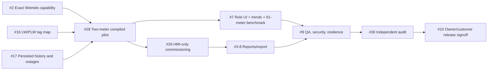

# UCS v1.0 — Requirements Traceability & Acceptance Evidence Matrix
**Source of truth:** [Final master plan](UCS_FINAL_MASTER_PLAN.md) · [Command Centre #1](https://github.com/raohassandev/Weintek-Macro-Javascript-based-reporting/issues/1).  
**Current phase:** baseline design. **NOTHING with DEVICE-PASS or CUSTOMER-ACCEPTED** without named Weintek hardware evidence.

## Evidence states / meaning
- **BASELINED:** requirement and acceptance test specified.
- **OFFLINE-TESTED:** code/contracts passing fixture checks; hardware unknown.
- **EBPRO-COMPILED:** named EBPro version successfully opens/compiles target project.
- **SIMULATOR-PASS:** exact EBPro simulation with recorded test artifacts, not physical device proof.
- **DEVICE-PASS:** actual connected target SKU/OS version, time, bench scripts/logs, observed results, release SHA.
- **CUSTOMER-ACCEPTED:** agreed KPI, approved site report, signed handover.
Any unobserved state is **NOT RUN**, never presumptive PASS.

## Requirements & verifiable outcomes

| ID | Priority | Acceptance requirement | Objective evidence / negative test | Tracking |
|---|---|---|---|---|
| UCS-001 | P0 | All runtime on eligible Weintek SVRX/FHDX; no computer/report server | Repository schema rejects external_service; physical diagram & deployment scan | #23 / #27 |
| UCS-002 | P0 | Named device SKU, OS, EBPro/version compatibility frozen | Rear-label/firmware/EBPro snapshot, native feature-matrix checklist | #2 |
| UCS-003 | P0 | 61 configurable analyzer slots; read-only acquisition | Site profile, 2 brands pilot, valid FC/data endian and unique IDs; 61 benchmark | #28 / #29 |
| UCS-004 | P0 | Site profile independent of hardware-specific register maps | Two distinct device driver profiles, same HMI detail, no copied 61 windows | #16 / #29 |
| UCS-005 | P0 | Meter Detail one template across different meters | Meter 1/2/37 visual values correct and capability-driven N/A | #15 / #28 |
| UCS-006 | P0 | Multi-user/client-private meter selection | Two simultaneous Viewer sessions select different meters without cross-talk | #15 |
| UCS-007 | P0 | User LW/LB/PLW/RW/system register allocations do not overlap | Contract automated collision check + actual EBPro system/control tag export | #16 |
| UCS-008 | P0 | Snapshot has quality and timestamps; stale isn't fresh | Lost comm, delayed poll, timestamp rollback, wrong meter metadata, guarded UI | #17 |
| UCS-009 | P0 | All commissioned meters logged in background independent of screen | Meter A viewed while B off/on, no viewer connected, latest B record proves capture | #17 / #28 |
| UCS-010 | P0 | Missing samples/communications failures represented as evidence, never zero | Timeout/error/recovered and no-observability intervals in exported report | #17 |
| UCS-011 | P0 | Recorder vs meter fault evidence separated | Meter unreachable / Weintek reboot / USB absent have distinct incident reasons; attribution confidence | #17 / #18 |
| UCS-012 | P0 | Data logger state and storage writing reliably verified | USB mounted but read-only; file probe passes but historian stops; independent fail states | #18 / #19 |
| UCS-013 | P0 | Native USB/microSD/SSD qualification and file rollover | exact media/firmware, FAT32 write/rotation, removal, full, restart/power-cycle tests | #18 |
| UCS-014 | P0 | Data timezones/intervals/energy calculations correct | Month/day/shift boundary, gap, counter reset, irregular integration, daylight offset | #3 / #4 / #9 |
| UCS-015 | P0 | Historic earliest/latest/persisted event clock truthful | Real stored-record boundary query and sample-count reconciliation | #4 / #17 |
| UCS-016 | P0 | Storage capacity forecast based on measurement not synthetic | 3–7 day observed growth + bytes used/free/reserve; display N/A if inadequate | #18 / #19 |
| UCS-017 | P0 | Operator Home purpose-complete | 61 status/major alarms/load, no privilege leakage, drilldown in tested EBPro | #7 / #24 |
| UCS-018 | P0 | Engineer Home complete troubleshooting/maintenance | error reason/rate and last good age, device tests, audit trail, safe writes | #7 / #29 |
| UCS-019 | P0 | Management Home purpose-complete executive reporting | daily/monthly KPIs, comparisons and quality; resources omitted unless critical | #7 / #24 |
| UCS-020 | P0 | Critical actionable events role-routed with durable audit | Event stored before popup; correct UAC role, dedupe/ack, reboot recovery and escalation | #24 / #9 |
| UCS-021 | P0 | Configurable UAC permissions enforced at action/data boundary | Unauthorized manager writes and backup restore blocked despite direct control access | #7 / #9 |
| UCS-022 | P0 | All metric formats show available supported measurements | Each meter driver presence flag, N/A if unsupported, no fake THD/fuel/harmonic values | #15 |
| UCS-023 | P1 | Reusable Trends show selected device's **persisted** history | Meter 1/2 independent query/view, gaps/trend downsampling, history source verified | #7 / #17 |
| UCS-024 | P0 | Daily/monthly/custom native historical reports reconcile | Exact totals and rows compare to raw records and gap ledger on selected device | #3 / #4 / #8 |
| UCS-025 | P0 | Site-aware multi-meter report templates with good quality | 22-catalog conditional activation; no unavailable tag included silently | #8 / #11 |
| UCS-026 | P0 | CSV exported on HMI and opens/reconciles externally as a **file viewer only** | Actual Weintek source file export, line-by-line totals, checksum | #8 |
| UCS-027 | P1 | Branded PDF/XLSX only if native on-device generator proven | Vendor evidence + physical file creation/validity; otherwise explicit UNSUPPORTED | #8 / #25 |
| UCS-028 | P0 | Backup has independent verification/recovery | Real backup file+hash, second removable media, correct restore, safe rollback and fail tests | #18 / #19 |
| UCS-029 | P0 | Resource Manager monitors CPU/RAM/flash/USB and quality truth | Live type-correct system tags; missing device N/A, no permanent stale PASS | #19 |
| UCS-030 | P0 | Commissioning UI handles supported predeclared driver configuration | Engineer role creates/edits 2 device profiles with test/apply/rollback in actual HMI | #29 |
| UCS-031 | P0 | Advanced unsupported drivers cannot be hot-added by fake UI | Attempt unsupported device model/protocol; explicit safe rejection/EBPro change request | #29 |
| UCS-032 | P0 | Firmware/software performance acceptable at site load | 61-meter poll plus logger and ≥2 viewers + charts/alarms, measured CPU/RAM/latency/data continuity | #9 / #17 |
| UCS-033 | P1 | HTML/Canvas path does not compromise native operation | JS Canvas renders; USB HTML browser path marked blocked if unsupported; high CPU test | #25 |
| UCS-034 | P0 | Storage failure and comm downtime survive alarm acknowledgement | Persistent event log, actual recovery timestamps, accurate incident KPI/report | #17 / #19 |
| UCS-035 | P0 | Secure repo and installation/recovery documentation | No secrets/private customer logs; rollback, device project backup, engineer runbook | #10 |
| UCS-036 | P0 | Real independent audit and customer acceptance | Issue #30 signed PASS with evidence refs + customer signoff #10 | #30 / #10 |

## Cross-issue acceptance dependencies


## Audit evidence packet format (per requirement)
```yaml
requirement_id: UCS-009
project_commit: <exact Git SHA>
github_pr: <PR number>
environment:
  model: <actual cMT SKU>
  hmi_os: <build/version>
  ebpro: <version>
  firmware: <build>
  media: <USB/SD SKU, filesystem, capacity>
data:
  meters: <IDs & models>
  interval_seconds: <real configured value>
  duration_minutes: <actual observation>
test:
  method: <reproducible steps/script>
  expected: <invariant>
  observed: <measured results>
  evidence: <link to logs/images, genuinely recorded>
verdict: PASS | FAIL | BLOCKED | NOT_RUN
reviewer: <independent human/agent>
```
The YAML is an **example evidence record schema**, not an actual test result or filename from existing hardware.

## Historical material preservation
Older decision documents can contain superseded proposals. Read [baseline](UCS_FINAL_MASTER_PLAN.md) first and use `D-018` (Weintek-only) as override. If an auditor finds an outdated issue still requesting PC/IPC, flag as stale and request issue correction rather than treating it as active implementation authorization.
