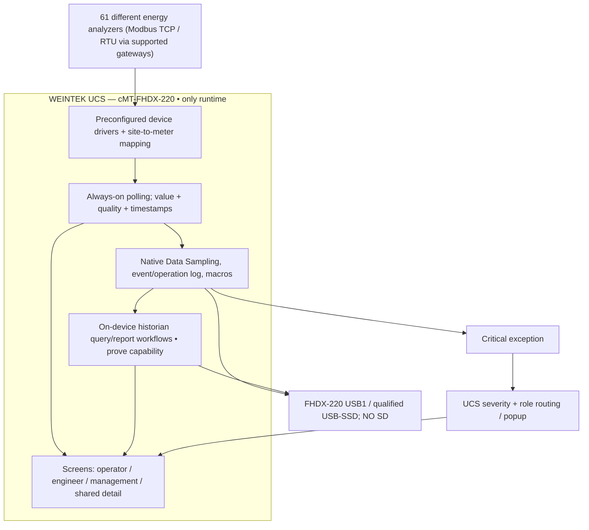
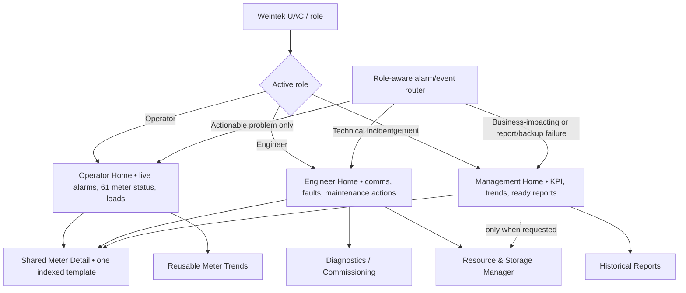
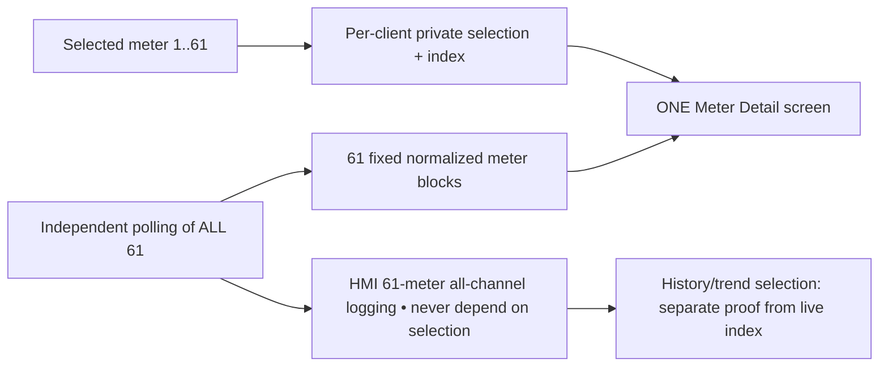
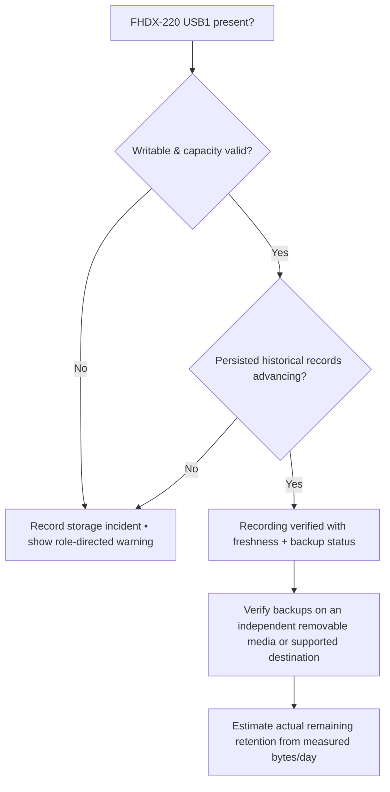
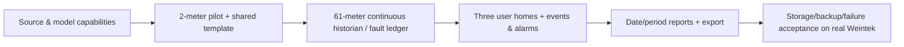

# UCS VISUAL PLAN — WEINTEK-ONLY ARCHITECTURE
**Current approved deployment rule (2026-10-13): no external PC/IPC, server or SQL computer.** Owner-selected **cMT-FHDX-220**; OS/firmware and 61-meter benchmark pending. [Hardware plan](HARDWARE_TARGET_FHDX_220.md). [Command Centre #1](https://github.com/raohassandev/Weintek-Macro-Javascript-based-reporting/issues/1) · [Role-based UI](ROLE_BASED_UX_PLAN.md) · [HTML evaluation](../research/WEINTEK_HTML_FEASIBILITY.md).

## A. Runtime / physical topology

**No external computer.** The native HMI historian's query/aggregation capability is NOT equivalent to unrestricted SQLite/HTML-server support. Complex/long-retention reports and 61-meter throughput require physical benchmarks before customer commitments.

## B. Screens follow user purpose

Home is a **purpose-complete summary**, not a dump of CPU/RAM/storage gauges. Resource and backup administrative views remain deep navigation; critical problems appear as notifications. All events must also appear in log and historian.

## C. One reusable meter screen / background historian

## D. Weintek-only storage lifecycle

Presence is not proof of write or persistence; backup on the same disk is not independent recovery.

## E. Engineer work phases

## Not supported as proven (yet)
- Arbitrary HTML `file:///usb1/index.html` via **PLC Web Browser**; HTML5 web panel `(W)` is browser-focused, not demonstrated direct EBPro historian runtime.
- Generic direct SQLite API in Macro/JS, or Advanced Mode custom SQL on Local SQLite for the exact target.
- Dynamic Trend Display index from client-private live index; proper history querying must be tested.
- Guaranteed zero missing samples under meter/device power loss; instead record explicit evidence of missing intervals.
