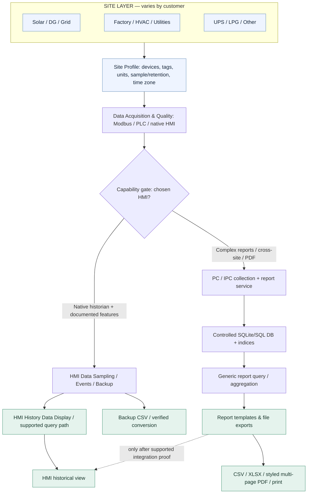
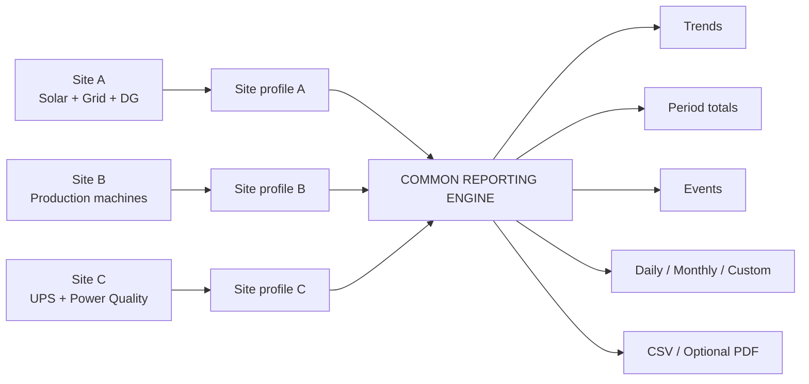
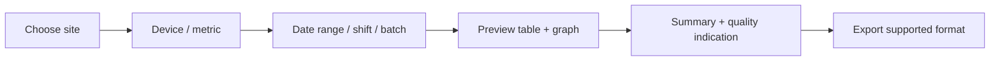

# Visual project plan — site-independent historian
**Owner entry point:** [One-screen dashboard](OWNER_DASHBOARD.md) · [Report catalog](REPORT_CATALOG.md) · [Command Centre #1](https://github.com/raohassandev/Weintek-Macro-Javascript-based-reporting/issues/1)

## 1. The complete system — one engine, different sites

> Architecture shows **two valid implementation routes**, not a claim that all features run on the HMI. Local USB/SD SQLite SQL Query and Advanced Mode combinations require explicit versioned proof.

## 2. Site differences affect configuration — not the universal platform

## 3. Historical report operator flow

## 4. Execution roadmap and owner touch-points

Owner needs to decide only **(i) which HMI/device is actually available** and **(ii) whether customer mandates styled PDF/print vs on-HMI + CSV**. Engineering team owns reading manuals, building fixtures, tests and issue/PR tracking.

## Current status
- Diagram/report catalog/config model: **DESIGN baseline**.
- Model support: manufacturer docs gathered; physical model/OS and local SQLite Advanced Mode **unverified**.
- Source code/report application/hardware acceptance: **NOT DELIVERED**. Do not sell all catalog reports as available today.
